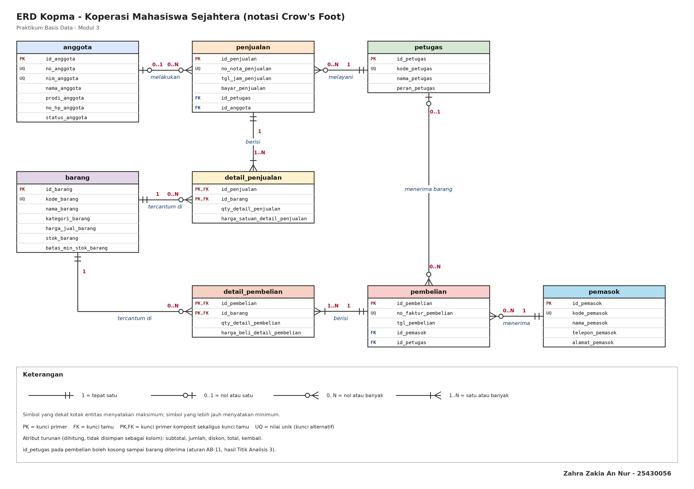
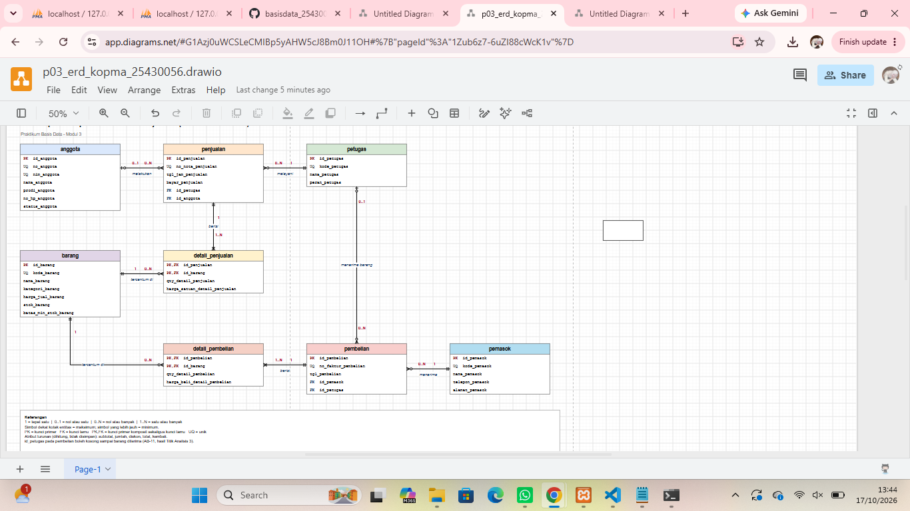
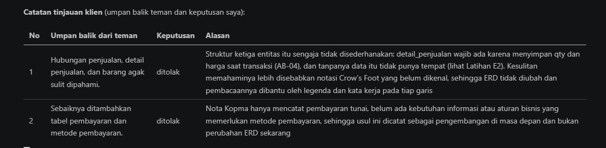
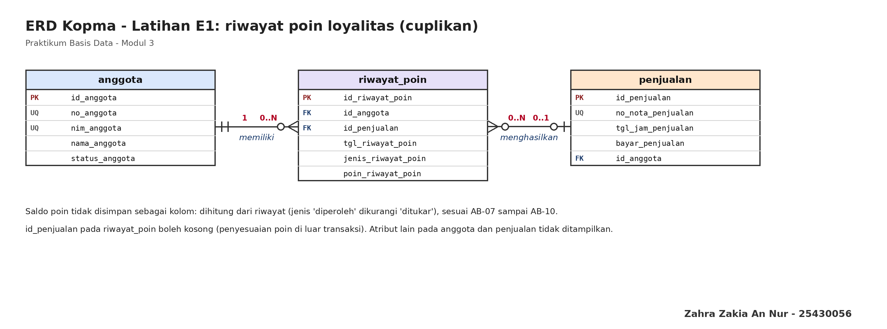
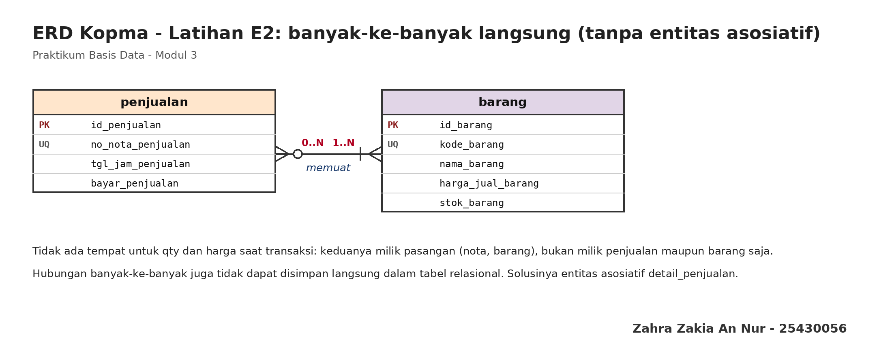
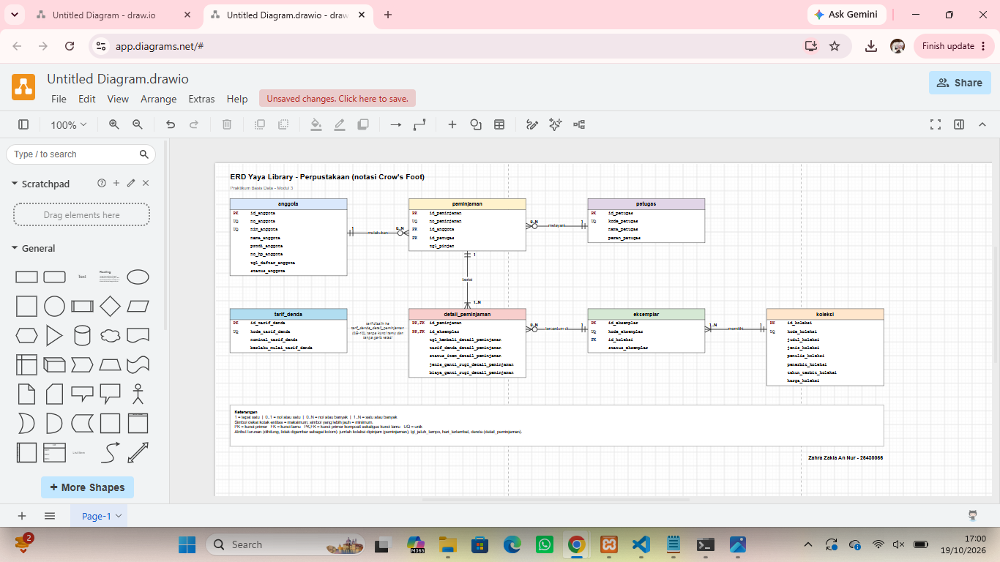
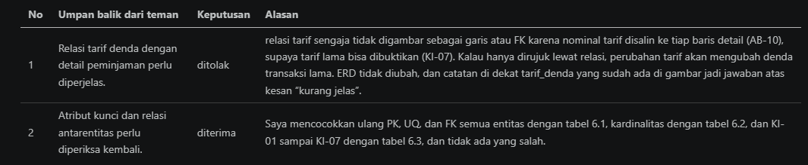
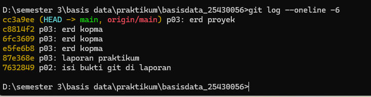

# Laporan Praktikum Basis Data - Pertemuan 3

**Nama:** Zahra Zakia An Nur    
**NPM:** 25430056    
**Kelas:** B    
**Tanggal:** 10 oktober 2026

## 1. Tujuan Praktikum

Praktikum ini bertujuan menerjemahkan dokumen kebutuhan data dari Pertemuan 2 menjadi model konseptual berupa ERD. Saya menentukan entitas, atribut, dan kunci, menetapkan relasi dengan kardinalitas yang dapat ditelusuri ke aturan bisnis, menggambar ERD dengan notasi Crow's Foot di draw.io, lalu memvalidasinya terhadap kebutuhan informasi.

## 2. Ringkasan Dasar Teori

ERD menggambarkan struktur data pada tingkat konseptual: entitas (kotak), atribut, dan relasi (garis). Setiap entitas punya kunci primer (PK) yang mengidentifikasi barisnya secara unik, dapat memiliki kunci alternatif yang juga unik, dan merujuk entitas lain lewat kunci tamu (FK). Kunci primer yang terdiri dari dua kolom disebut komposit.

Kardinalitas menyatakan berapa banyak paling banyak, sedangkan partisipasi menyatakan wajib atau boleh tidak ada. Notasi Crow's Foot menggabungkan keduanya di ujung garis: simbol yang dekat kotak entitas menyatakan maksimum, simbol yang lebih jauh menyatakan minimum. Relasi banyak-ke-banyak tidak dapat disimpan langsung dalam tabel relasional, sehingga diselesaikan dengan entitas asosiatif yang menyimpan atribut relasinya. Atribut turunan tidak digambar sebagai kolom biasa karena dapat dihitung dari data lain.

## 3. Hasil Langkah Percobaan (ERD Kopma)

### D.1 Dari entitas kandidat ke entitas

Dari tabel entitas kandidat Pertemuan 2, saya menandai kunci primer, kunci alternatif, dan atribut turunan. Entitas "Pembelian dan detailnya" saya pecah menjadi `pembelian` dan `detail_pembelian`, dengan pola yang sama seperti penjualan. Atribut turunan (subtotal, jumlah, diskon, total, kembali) tidak digambar sebagai kolom karena dihitung dari data lain.

| Entitas | Kunci primer | Kunci alternatif (unik) | Kunci tamu | Keterangan |
|---|---|---|---|---|
| anggota | id_anggota | no_anggota, nim_anggota | - | |
| petugas | id_petugas | kode_petugas | - | |
| barang | id_barang | kode_barang | - | |
| penjualan | id_penjualan | no_nota_penjualan | id_petugas, id_anggota | id_anggota boleh kosong (AB-02) |
| detail_penjualan | id_penjualan + id_barang (komposit) | - | id_penjualan, id_barang | atribut sendiri: qty, harga satuan saat transaksi (AB-04) |
| pemasok | id_pemasok | kode_pemasok | - | |
| pembelian | id_pembelian | no_faktur_pembelian | id_pemasok, id_petugas | id_petugas kosong sampai barang diterima (AB-11) |
| detail_pembelian | id_pembelian + id_barang (komposit) | - | id_pembelian, id_barang | atribut sendiri: qty, harga beli |

### D.2 Relasi dan kardinalitas

Setiap pasangan entitas yang berhubungan saya tulis sebagai kalimat dengan kata kerja, lalu saya tanyakan "minimal berapa" dan "maksimal berapa" dari kedua arah, dengan kode aturan bisnis sebagai dasarnya. Enam relasi pertama berasal dari analisis Pertemuan 2, relasi ketujuh ditambahkan karena `detail_pembelian` harus merujuk ke satu barang, dan relasi kedelapan berasal dari Titik Analisis 3.

| Relasi | Sisi kiri | Sisi kanan | Dasar |
|---|---|---|---|
| petugas melayani penjualan | tepat satu petugas | nol atau banyak penjualan | Narasi: kasir mencatat penjualan |
| anggota melakukan penjualan | nol atau satu anggota | nol atau banyak penjualan | AB-02 |
| penjualan berisi detail_penjualan | tepat satu penjualan | satu atau banyak detail | AB-01 |
| barang tercantum di detail_penjualan | tepat satu barang | nol atau banyak detail | AB-04 |
| pemasok menerima pembelian | tepat satu pemasok | nol atau banyak pembelian | AB-06 |
| pembelian berisi detail_pembelian | tepat satu pembelian | satu atau banyak detail | Faktur pemasok |
| barang tercantum di detail_pembelian | tepat satu barang | nol atau banyak detail | Faktur pemasok (PB-03, PB-04) |
| petugas menerima pembelian | nol atau satu petugas | nol atau banyak pembelian | AB-11 (Titik Analisis 3) |

Aturan bisnis baru yang muncul dari analisis ini:

| Kode | Aturan bisnis |
|---|---|
| AB-11 | Setiap pembelian yang barangnya sudah diterima dicatat bersama petugas gudang yang menerimanya. Sebelum barang diterima, petugas penerima boleh kosong. |

### D.3 Menggambar ERD

Gambar 3.1 menampilkan delapan entitas dengan satu warna per entitas, semua atribut dari kamus data, label PK/FK/PK,FK, simbol Crow's Foot dengan label angka di kedua ujung garis, serta legenda di bagian bawah. Nama organisasi ada di judul dan nama serta NIM di sudut kanan bawah.

Gambar 3.2 menunjukkan berkas sumber `.drawio` dibuka di draw.io.

### D.4 Validasi terhadap kebutuhan informasi

Keempat kebutuhan informasi dapat ditelusuri ke jalur di ERD. Karena semuanya tertelusuri, tidak ada entitas atau relasi yang kurang.

| Kode | Kebutuhan informasi | Jalur di ERD | Atribut yang dipakai |
|---|---|---|---|
| KI-01 | Omzet dan jumlah nota per hari dan per bulan | penjualan, detail_penjualan | tgl_jam_penjualan, qty_detail_penjualan, harga_satuan_detail_penjualan |
| KI-02 | Lima barang terlaris per bulan | penjualan, detail_penjualan, barang | tgl_jam_penjualan, qty_detail_penjualan, nama_barang |
| KI-03 | Barang dengan stok di bawah batas minimum | barang | stok_barang, batas_min_stok_barang |
| KI-04 | Sepuluh anggota dengan belanja terbesar per bulan | anggota, penjualan, detail_penjualan | nama_anggota, tgl_jam_penjualan, qty, harga satuan |

Catatan untuk Modul 4: diskon 5% dihitung dari status anggota. Jika status anggota berubah kemudian, hasil hitung ulang omzet lama bisa ikut berubah. Keputusan menyimpan atau menghitung total dibahas di Modul 4.

**Catatan tinjauan klien** (umpan balik teman dan keputusan saya):

| No | Umpan balik dari teman | Keputusan | Alasan |
|---|---|---|---|
| 1 | Hubungan penjualan, detail penjualan, dan barang agak sulit dipahami. | Ditolak | Struktur ketiga entitas itu sengaja tidak disederhanakan: `detail_penjualan` wajib ada karena menyimpan qty dan harga saat transaksi (AB-04), dan tanpanya data itu tidak punya tempat (lihat Latihan E2). Kesulitan memahaminya kemungkinan disebabkan notasi Crow's Foot yang belum dikenal, sehingga ERD tidak diubah dan pembacaannya dibantu oleh legenda dan kata kerja pada tiap garis. |
| 2 | Sebaiknya ditambahkan tabel pembayaran dan metode pembayaran. | Ditolak | Nota Kopma hanya mencatat pembayaran tunai, belum ada kebutuhan informasi atau aturan bisnis yang memerlukan metode pembayaran, sehingga usul ini dicatat sebagai pengembangan di masa depan dan bukan perubahan ERD sekarang. |

## 4. Jawaban Titik Analisis

**Titik Analisis 1**

`no_anggota` dan `nim_anggota` sama-sama unik. Mengapa buku ini tetap memakai `id_anggota` sebagai kunci primer? Sebutkan satu risiko jika NIM dijadikan kunci primer.

Kunci primer dirujuk oleh tabel lain sebagai kunci tamu, jadi nilainya sebaiknya tidak pernah berubah dan tidak bergantung pada pihak di luar sistem. NIM dan nomor anggota berasal dari aturan di luar basis data (kampus dan koperasi) dan bisa dikoreksi atau berganti format. Dengan `id_anggota` sebagai kunci buatan sistem, data seperti NIM tetap bisa diperbaiki tanpa menyentuh tabel lain. Risiko jika NIM menjadi kunci primer: bila NIM salah ketik atau dikoreksi kemudian, perubahan itu harus diteruskan ke seluruh baris penjualan yang merujuknya, dan NIM yang merupakan data pribadi ikut tersalin ke banyak tabel.

**Titik Analisis 2**

Sisi penjualan terhadap `detail_penjualan` bernilai satu atau banyak, bukan nol atau banyak. Aturan bisnis mana yang memaksanya? Apakah aturan "minimal satu" ini dapat dijaga oleh struktur tabel saja?

Aturan yang memaksanya adalah AB-01: setiap nota memuat minimal satu baris barang. Struktur tabel saja belum cukup. Kunci tamu pada detail hanya menjamin bahwa setiap detail merujuk ke penjualan yang ada. Tidak ada yang melarang penjualan tersimpan tanpa satu pun detail. Aturan "minimal satu" perlu dijaga dengan transaksi yang menyimpan penjualan dan detailnya sekaligus (dibahas di Modul 14) atau oleh logika aplikasi.

**Titik Analisis 3**

Ketua ingin mengetahui "petugas gudang mana yang menerima barang dari pemasok". Apakah ERD saat ini dapat menjawabnya? Jika belum, relasi apa yang perlu ditambahkan, dan apakah keputusan itu perlu dicatat sebagai aturan bisnis baru?

ERD awal belum bisa menjawabnya, karena entitas `pembelian` hanya berhubungan dengan `pemasok` dan tidak merekam petugas yang menerima barang. Perlu ditambahkan relasi `petugas menerima pembelian`, yaitu kunci tamu `id_petugas` pada `pembelian`. Kolom ini boleh kosong karena pesanan dibuat lebih dulu daripada barang diterima, sehingga sisi petugas bernilai nol atau satu. Keputusan ini perlu dicatat sebagai aturan bisnis baru, yaitu AB-11, supaya kardinalitas relasinya punya dasar.

## 5. Hasil Latihan dan Modifikasi

### Latihan E1: poin loyalitas

Poin tidak cukup menjadi atribut `anggota`. Atribut saldo hanya menyimpan hasil akhir, sehingga tidak dapat menjawab dari mana saldo itu berasal, tidak bisa ditelusuri atau diperiksa bila ada keluhan, dan melanggar AB-10 yang mengharuskan poin diperoleh dan ditukar tercatat per transaksi. Karena itu saya menambahkan entitas `riwayat_poin` (PK `id_riwayat_poin`; FK `id_anggota` dan `id_penjualan`; atribut tanggal, jenis, dan jumlah poin). Saldo poin dihitung dari riwayat.

Relasi: satu anggota memiliki nol atau banyak riwayat poin, dan satu penjualan menghasilkan nol atau banyak riwayat poin; `id_penjualan` boleh kosong untuk penyesuaian di luar transaksi.

### Latihan E2: banyak-ke-banyak langsung

Jika penjualan dan barang dihubungkan langsung, data yang hilang adalah `qty` dan harga saat transaksi (AB-04). Keduanya adalah milik pasangan (nota, barang), bukan milik penjualan maupun barang saja, sehingga tidak punya tempat. Relasi banyak-ke-banyak juga tidak dapat disimpan langsung dalam tabel relasional, jadi diselesaikan dengan entitas asosiatif `detail_penjualan` yang berhubungan satu-ke-banyak dengan kedua entitas asalnya.

## 6. Tugas Mandiri: Milestone Proyek 3 (ERD Proyek)

| Item | Isian |
|---|---|
| Tema | Perpustakaan |
| Nama organisasi | Yaya Library |
| Berkas ERD | `p03_erd_25430056.drawio` dan `p03_erd_25430056.png` |

### 6.1 Entitas, atribut, dan kunci (7 entitas)

| Entitas | Kunci primer | Kunci alternatif (unik) | Kunci tamu | Atribut lain | Atribut turunan |
|---|---|---|---|---|---|
| anggota | id_anggota | no_anggota, nim_anggota | - | nama_anggota, prodi_anggota, no_hp_anggota, tgl_daftar_anggota, status_anggota | - |
| petugas | id_petugas | kode_petugas | - | nama_petugas, peran_petugas | - |
| koleksi | id_koleksi | kode_koleksi | - | judul_koleksi, jenis_koleksi, penulis_koleksi, penerbit_koleksi, tahun_terbit_koleksi, harga_koleksi | - |
| eksemplar | id_eksemplar | kode_eksemplar | id_koleksi | status_eksemplar | - |
| peminjaman | id_peminjaman | no_peminjaman | id_anggota, id_petugas | tgl_pinjam | jumlah koleksi dipinjam |
| detail_peminjaman | id_peminjaman + id_eksemplar (komposit) | - | id_peminjaman, id_eksemplar | tgl_kembali_detail_peminjaman, tarif_denda_detail_peminjaman (tarif saat transaksi, AB-10), status_item_detail_peminjaman, jenis_ganti_rugi_detail_peminjaman, biaya_ganti_rugi_detail_peminjaman | tgl_jatuh_tempo, hari_terlambat, denda (disimpan atau dihitung diputuskan di Modul 4) |
| tarif_denda | id_tarif_denda | kode_tarif_denda | - | nominal_tarif_denda, berlaku_mulai_tarif_denda | - |

Entitas asosiatif: `detail_peminjaman`. Tanggal kembali, tarif denda saat transaksi, status item, dan ganti rugi adalah milik pasangan (peminjaman, eksemplar), bukan milik peminjaman maupun eksemplar saja.

### 6.2 Relasi dan kardinalitas

| Relasi (kalimat) | Sisi kiri | Sisi kanan | Dasar (AB/PB) |
|---|---|---|---|
| koleksi memiliki eksemplar | tepat satu koleksi | satu atau banyak eksemplar | AB-03 |
| anggota melakukan peminjaman | tepat satu anggota | nol atau banyak peminjaman | AB-02, AB-05 |
| petugas melayani peminjaman | tepat satu petugas | nol atau banyak peminjaman | AB-05 |
| peminjaman berisi detail_peminjaman | tepat satu peminjaman | satu atau banyak detail | AB-05 |
| eksemplar tercantum di detail_peminjaman | tepat satu eksemplar | nol atau banyak detail | AB-04, AB-07 |
| tarif_denda berlaku pada detail_peminjaman (diputuskan tidak terhubung lewat kunci tamu) | tidak digambar sebagai garis | tidak digambar sebagai garis | AB-10 |

Keputusan untuk relasi terakhir: nominal tarif disalin ke `tarif_denda_detail_peminjaman` pada setiap baris detail, sehingga `detail_peminjaman` tidak punya kunci tamu ke `tarif_denda`. Entitas `tarif_denda` tetap ada sebagai daftar tarif beserta tanggal mulai berlakunya.

### 6.3 Penelusuran kebutuhan informasi ke jalur ERD (semua KI proyek)

| Kode | Kebutuhan informasi | Jalur di ERD | Atribut yang dipakai |
|---|---|---|---|
| KI-01 | Sepuluh koleksi yang paling sering dipinjam per bulan | peminjaman, detail_peminjaman, eksemplar, koleksi | tgl_pinjam, id_eksemplar, judul_koleksi |
| KI-02 | Sepuluh anggota paling aktif per bulan | anggota, peminjaman | nama_anggota, tgl_pinjam |
| KI-03 | Daftar koleksi yang lewat batas kembali | anggota, peminjaman, detail_peminjaman, eksemplar, koleksi | tgl_pinjam, tgl_kembali, judul_koleksi, nama_anggota |
| KI-04 | Total denda yang terkumpul per bulan | detail_peminjaman | tgl_kembali, tarif denda, denda |
| KI-05 | Jumlah eksemplar tersedia, dipinjam, dan hilang per judul | koleksi, eksemplar | judul_koleksi, status_eksemplar |
| KI-06 | Koleksi yang belum dikembalikan pada suatu transaksi | peminjaman, detail_peminjaman, eksemplar, koleksi | no_peminjaman, tgl_kembali, judul_koleksi |
| KI-07 | Bukti tarif denda yang berlaku pada transaksi lama | peminjaman, detail_peminjaman | tgl_pinjam, tarif denda saat transaksi |

Semua kebutuhan informasi dapat ditelusuri ke jalur di ERD.

### 6.4 Pemetaan entitas ke Pertemuan 2

| Entitas | Berasal dari (PB/KI) |
|---|---|
| anggota | PB-01 |
| petugas | PB-06 |
| koleksi | PB-02 |
| eksemplar | PB-02 |
| peminjaman | PB-03 |
| detail_peminjaman | PB-03, PB-04 |
| tarif_denda | PB-06 |

### 6.5 ERD proyek

### 6.6 Catatan tinjauan klien proyek

| No | Umpan balik dari teman | Keputusan | Alasan |
|---|---|---|---|
| 1 | Relasi tarif denda dengan detail peminjaman perlu diperjelas. | ditolak | Relasi tarif sengaja tidak digambar sebagai garis atau FK karena nominal tarif disalin ke tiap baris detail (AB-10), supaya tarif lama bisa dibuktikan (KI-07). Kalau hanya dirujuk lewat relasi, perubahan tarif akan mengubah denda transaksi lama. ERD tidak diubah, dan catatan di dekat tarif_denda yang sudah ada di gambar jadi jawaban atas kesan “kurang jelas”. |
| 2 | Atribut kunci dan relasi antarentitas perlu diperiksa kembali. | diterima | Saya mencocokkan ulang PK, UQ, dan FK semua entitas dengan tabel 6.1, kardinalitas dengan tabel 6.2, dan KI-01 sampai KI-07 dengan tabel 6.3, dan tidak ada yang salah. |

Penjelasan keputusan desain (alasan kardinalitas relasi utama):

1. **koleksi ke eksemplar (tepat satu ke satu atau banyak).** Satu judul dapat memiliki beberapa salinan fisik, dan petugas perlu tahu salinan mana yang sedang keluar, sehingga status dicatat di `eksemplar`, bukan di `koleksi` (AB-03). Setiap eksemplar pasti salinan dari satu judul, jadi sisi koleksi tepat satu.
2. **anggota ke peminjaman (tepat satu ke nol atau banyak).** Peminjaman selalu atas nama satu anggota (AB-02, AB-05). Berbeda dengan penjualan Kopma yang boleh tanpa anggota, di sini sisi anggota tepat satu. Anggota yang belum pernah meminjam tetap sah, sehingga sisi peminjaman nol atau banyak.
3. **petugas ke peminjaman (tepat satu ke nol atau banyak).** Setiap transaksi dicatat oleh satu petugas yang melayani (AB-05), sedangkan petugas baru boleh belum pernah melayani transaksi.
4. **peminjaman ke detail_peminjaman (tepat satu ke satu atau banyak).** Peminjaman tanpa koleksi yang dipinjam tidak bermakna (AB-05). Seperti pada Kopma, aturan "minimal satu" ini tidak dapat dijaga oleh struktur tabel saja, melainkan oleh transaksi atau logika aplikasi.
5. **eksemplar ke detail_peminjaman (tepat satu ke nol atau banyak).** Satu eksemplar dapat dipinjam berulang kali sepanjang riwayatnya, tetapi setiap baris detail merujuk ke tepat satu eksemplar (AB-04, AB-07).
6. **tarif_denda dan detail_peminjaman (tidak terhubung).** Tarif disalin ke tiap baris detail (AB-10) agar tarif lama dapat dibuktikan walaupun nominal tarif kemudian berubah. Bila tarif hanya dirujuk lewat relasi, perubahan tarif akan ikut mengubah denda transaksi lama, masalah yang sama dengan harga pada nota Kopma.
7. **detail_peminjaman sebagai entitas asosiatif.** Tanggal kembali, tarif denda saat transaksi, status item, dan ganti rugi adalah milik pasangan (peminjaman, eksemplar). Anggota sering mengembalikan sebagian dulu, jadi tanggal kembali harus per baris, bukan per peminjaman (AB-08).

## 7. Pembahasan dan Kendala

Kendala pertama berkaitan dengan alat. Berkas `.drawio` yang saya buka awalnya menampilkan kanvas kosong. Saya mengatasinya dengan membuat diagram kosong di app.diagrams.net, menempelkan isi XML-nya lewat Extras, Edit Diagram, lalu menyimpan ulang berkas dari draw.io sendiri sehingga formatnya valid.

Kendala kedua adalah menentukan kardinalitas yang dapat ditelusuri ke aturan bisnis. Pada Kopma, relasi antara petugas dan pembelian awalnya tidak ada. Titik Analisis 3 menunjukkan ERD belum bisa menjawab petugas gudang mana yang menerima barang, sehingga saya menambahkan `id_petugas` pada `pembelian` yang boleh kosong sampai barang diterima, dan mencatatnya sebagai AB-11.

Kendala ketiga muncul dari tinjauan klien: teman saya merasa hubungan penjualan, detail_penjualan, dan barang sulit dipahami. Saya menolak mengubah strukturnya karena `detail_penjualan` memang diperlukan untuk menyimpan qty dan harga saat transaksi (AB-04), tetapi saya menyadari ERD perlu dibaca dengan bantuan legenda dan kata kerja pada tiap garis.

Kendala keempat muncul pada ERD proyek Yaya Library, yaitu memutuskan di mana tarif denda disimpan. Jika `detail_peminjaman` hanya merujuk ke `tarif_denda`, perubahan tarif akan mengubah denda transaksi lama, sama seperti harga pada nota Kopma. Karena itu nominal tarif saya salin ke setiap baris detail (AB-10) dan `tarif_denda` tidak dihubungkan lewat kunci tamu. Konsekuensinya, saya perlu memastikan di Pertemuan 4 bahwa salinan ini tidak dianggap pengulangan data yang salah.

Kendala kelima adalah petugas pengembalian. Pada ERD saat ini hanya petugas yang melayani peminjaman yang tercatat (`id_petugas` pada `peminjaman`), sedangkan buku dikembalikan per baris detail dan mungkin dilayani petugas lain. Saya mencatat ini sebagai hal yang perlu ditinjau ulang bila perpustakaan membutuhkan informasi petugas pengembalian.

Kendala keenam adalah atribut turunan. Jatuh tempo, hari terlambat, dan denda dapat dihitung dari `tgl_pinjam`, `tgl_kembali`, dan tarif, sehingga tidak digambar sebagai kolom biasa. Namun denda dibayar tunai, jadi keputusan apakah denda disimpan atau dihitung saya tunda ke Modul 4.

## 8. Kesimpulan

ERD yang baik dibangun dari dokumen kebutuhan data: setiap entitas berasal dari proses bisnis, setiap relasi punya dasar aturan bisnis, dan setiap kebutuhan informasi harus dapat ditelusuri ke jalur di ERD. Entitas asosiatif diperlukan ketika ada data yang menjadi milik pasangan dua entitas, dan tinjauan klien membantu menemukan bagian yang sulit dipahami pembaca. ERD proyek Yaya Library terdiri dari tujuh entitas dengan `detail_peminjaman` sebagai entitas asosiatif, dan ketujuh kebutuhan informasinya dapat ditelusuri ke jalur di ERD.

## 9. Pernyataan Penggunaan AI

| Butir | Isian |
|---|---|
| Alat yang dipakai | Claude (Anthropic) |
| Dipakai untuk | Menjelaskan konsep, membuat draf awal ERD Kopma (berkas .drawio dan .png), serta draf jawaban Titik Analisis dan latihan; juga membantu mengisi kerangka ERD proyek (berkas .drawio), tabel relasi dan kardinalitas proyek, penjelasan keputusan desain, serta bagian pembahasan dan kesimpulan, atas izin dosen |
| Bagian laporan terkait | Bagian 1 sampai 8 (draf awal), yang saya baca, periksa, dan ubah dengan bahasa sendiri |
| Yang dikerjakan sendiri | Membuka dan merapikan ERD Kopma dan ERD proyek di draw.io, mencocokkannya dengan tabel entitas dan relasi, mengambil tangkapan layar, meminta teman meninjau ERD proyek lalu memutuskan menerima atau menolak tiap umpan balik, serta melakukan commit ke repositori. |

## 10. Bukti Git

Tautan repositori: https://github.com/zahraazakiaannur-cmd/basisdata_25430056

| Hash commit | Pesan commit | Keterangan |
|---|---|---|
| | p03: erd kopma | |
| | p03: erd proyek | |
| | p03: laporan praktikum | |

## Checklist

**Checklist umum**

- [ ] Identitas: nama, NIM, kelas, pertemuan, tanggal, nama asisten/dosen
- [ ] Tujuan: bahasa sendiri, maksimal 5 baris
- [ ] Ringkasan teori: pemahaman sendiri, maksimal setengah halaman
- [ ] Langkah percobaan (D): tangkapan layar langkah kunci dengan keterangan
- [ ] Titik Analisis: semua dijawab lengkap dengan alasan
- [ ] Latihan (E): hasil latihan beserta bukti
- [ ] Tugas Mandiri (F): berkas, bukti, dan penjelasan keputusan desain
- [ ] Pembahasan dan kendala
- [ ] Kesimpulan: dua sampai empat kalimat
- [ ] Pernyataan Penggunaan AI
- [ ] Bukti Git: tautan repositori dan hash commit berpesan `p03: ...`
- [ ] Keaslian: nama berkas, nama organisasi pada judul diagram, dan tanda tangan (nama + NIM) ada di ERD

**Checklist khusus Pertemuan 3**

- [ ] Berkas wajib: `p03_erd_kopma_<NIM>` dan `p03_erd_<NIM>` (gambar dan berkas sumber diagram)
- [ ] Bukti tangkapan layar: ERD di draw.io dengan kardinalitas terbaca; catatan tinjauan klien
- [ ] Analisis wajib: pemetaan setiap entitas ke PB/KI dari Pertemuan 2; alasan kardinalitas relasi utama