# Laporan Praktikum Basis Data - Pertemuan 4

**Nama:** Zahra Zakia An Nur  
**NPM:** 25430056  
**Kelas:** B  
**Tanggal:** 18 oktober 2026

## 1. Tujuan Praktikum

Praktikum ini bertujuan menguji ERD dari Pertemuan 3 dengan normalisasi. Saya mengenali anomali ubah, sisip, dan hapus, menuliskan dependensi fungsional dari aturan bisnis, menormalisasi relasi sampai 3NF dan memeriksa BCNF, lalu memutuskan apakah setiap nilai turunan disimpan atau dihitung.

## 2. Ringkasan Dasar Teori

Data yang disimpan berulang dalam satu tabel besar menimbulkan anomali: anomali ubah (satu fakta tertulis di banyak baris dan bisa tidak konsisten), sisip (fakta tidak bisa dicatat sebelum fakta lain ada), dan hapus (menghapus satu fakta ikut menghilangkan fakta lain). Normalisasi dipakai untuk menghilangkan anomali itu.

Dependensi fungsional A → B berarti setiap nilai A menentukan tepat satu nilai B. Dependensi diturunkan dari aturan bisnis, bukan ditebak dari contoh data, karena contoh data hanya dapat membantah dependensi dan tidak dapat membuktikannya. 1NF menghilangkan grup berulang, 2NF menghilangkan ketergantungan pada sebagian kunci komposit, 3NF menghilangkan rantai transitif, dan BCNF mensyaratkan setiap penentu adalah kunci kandidat. Kunci pengganti `id_*` tidak menghapus dependensi fungsional, sehingga pemeriksaan tetap memakai kunci alami.

## 3. Hasil Langkah Percobaan (Normalisasi Kopma)

Berkas: `p04_normalisasi_kopma_25430056.md`.

- **D.1 UNF ke 1NF.** Relasi spreadsheet lama (satu nota dengan grup berulang barang) diubah menjadi satu baris per barang per nota dengan kunci `(no_nota_penjualan, kode_barang)`. Tiga anomali ditunjukkan dengan contoh Kopma.
- **D.2 Dependensi fungsional.** Sembilan dependensi (FD1 sampai FD9) beserta kode AB, ditambah tiga dependensi yang sengaja saya nyatakan tidak berlaku, termasuk `kode_barang → harga_satuan_detail_penjualan` (AB-04).
- **D.3 2NF dan 3NF.** Penjualan, barang, petugas, dan anggota dipisah dari detail penjualan. Sisi pembelian memakai pola yang sama. Subtotal, jumlah, diskon, total, dan kembali dihitung, sedangkan `bayar_penjualan` disimpan.
- **D.4 Skema kanonik dan BCNF.** Delapan tabel dicocokkan dengan skema kanonik. Pemeriksaan BCNF per tabel menunjukkan semua penentu adalah kunci kandidat.

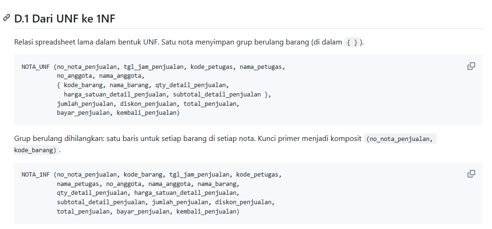

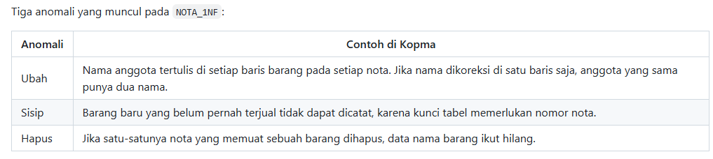

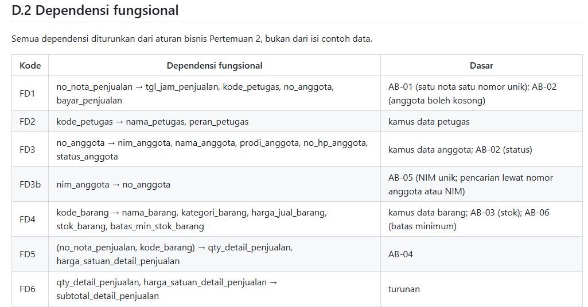

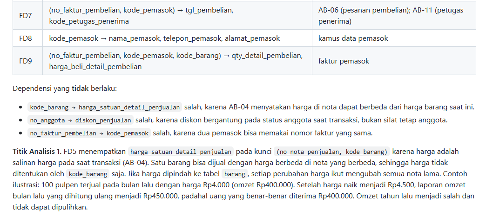

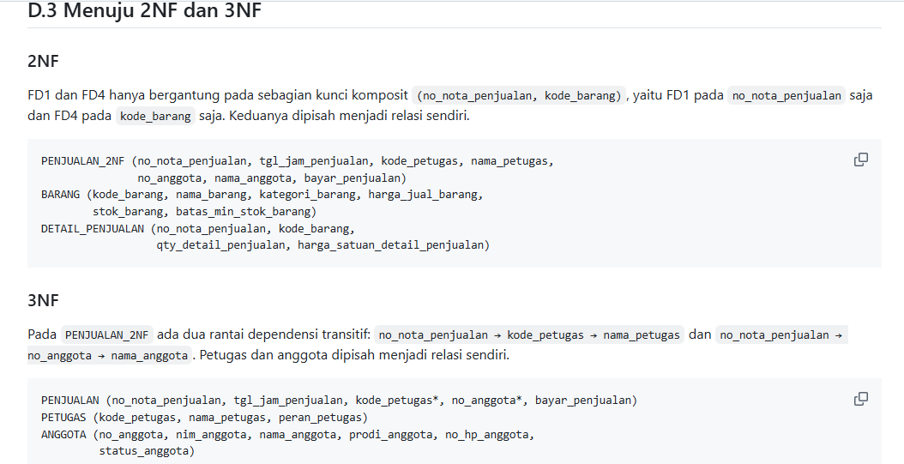

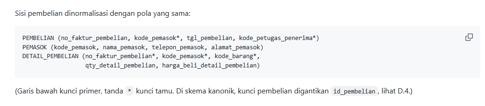

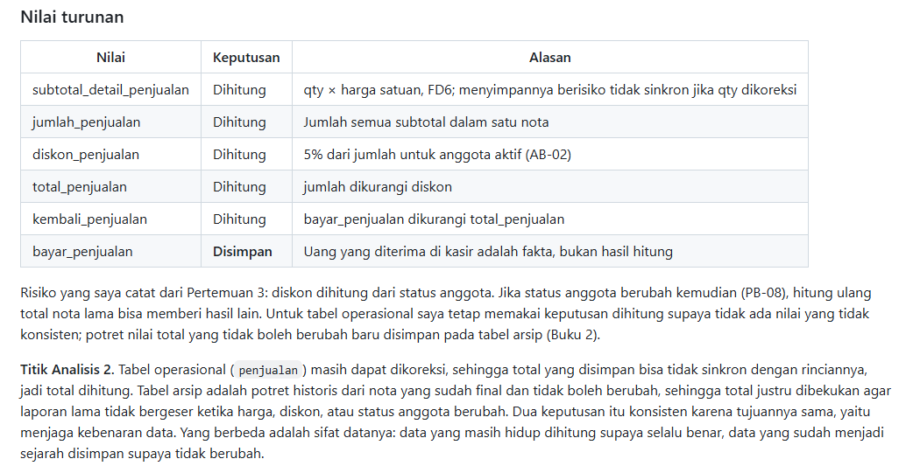

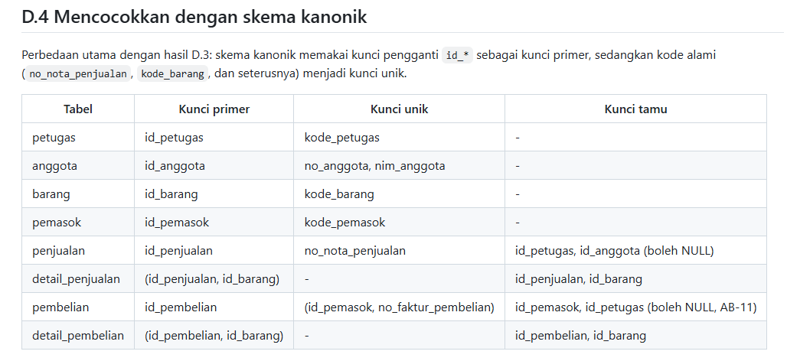

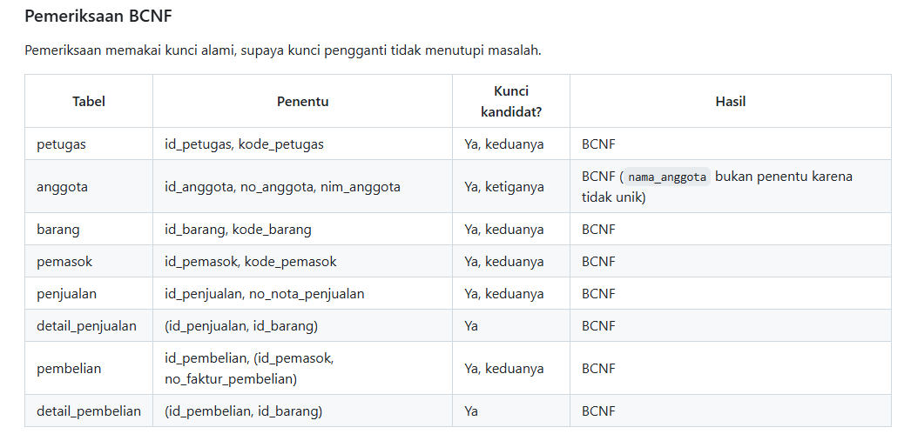

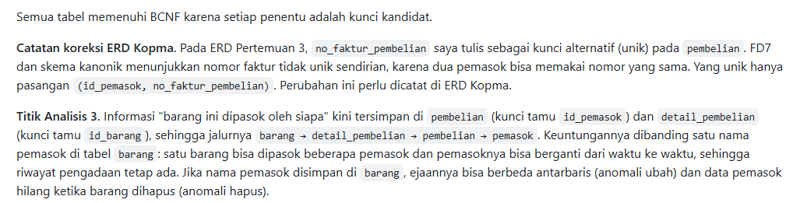

## 4. Jawaban Titik Analisis

**Titik Analisis 1.** `harga_satuan_detail_penjualan` berada pada kunci `(no_nota_penjualan, kode_barang)` karena harga adalah salinan harga saat transaksi (AB-04), sehingga satu barang bisa terjual dengan harga berbeda di nota berbeda. Jika harga dipindah ke tabel barang, setiap perubahan harga ikut mengubah semua nota lama. Contohnya, 100 pulpen terjual Rp4.000 menghasilkan omzet Rp400.000, tetapi setelah harga naik menjadi Rp4.500, omzet lama dihitung ulang menjadi Rp450.000. Omzet tahun lalu menjadi salah dan tidak dapat dipulihkan.

**Titik Analisis 2.** Tabel operasional masih dapat dikoreksi, sehingga total dihitung agar tidak ada nilai yang bisa tidak sinkron. Tabel arsip adalah potret historis dari nota yang sudah final, sehingga total dibekukan agar laporan lama tidak bergeser ketika harga, diskon, atau status anggota berubah. Dua keputusan itu konsisten karena tujuannya sama, yaitu menjaga kebenaran data; yang berbeda hanya sifat datanya, yaitu data yang masih hidup dan data yang sudah menjadi sejarah.

**Titik Analisis 3.** Informasi pemasok barang kini tersimpan di `pembelian` (kunci tamu `id_pemasok`) dan `detail_pembelian` (kunci tamu `id_barang`). Keuntungannya dibanding satu nama pemasok di tabel barang: satu barang bisa punya beberapa pemasok dan berganti pemasok dari waktu ke waktu, sehingga riwayat pengadaan terjaga. Menyimpan nama pemasok di barang membuat ejaannya bisa berbeda antarbaris dan datanya hilang ketika barang dihapus.

## 5. Hasil Latihan dan Modifikasi

**Latihan E1: beberapa nomor telepon pemasok.** Atribut `telepon_pemasok` melanggar 1NF jika berisi daftar nomor, sehingga dipindah ke relasi `TELEPON_PEMASOK (id_telepon_pemasok, id_pemasok*, no_telepon_pemasok)` dengan kunci unik `(id_pemasok, no_telepon_pemasok)`. Satu pemasok memiliki nol atau banyak nomor telepon.

**Latihan E2: anomali ubah.** Jika `nama_anggota` disimpan di `penjualan`, rantai `id_penjualan → id_anggota → nama_anggota` melanggar 3NF. Mengubah nama di satu nota saja membuat anggota yang sama punya dua nama.

```sql
UPDATE penjualan SET nama_anggota = 'Budi S.' WHERE no_nota_penjualan = 'PJ-2610-0001';
SELECT DISTINCT id_anggota, nama_anggota FROM penjualan WHERE id_anggota = 7;
```

Kueri kedua menampilkan dua nama untuk `id_anggota` 7. Pada rancangan 3NF, nama hanya ada di `anggota`.

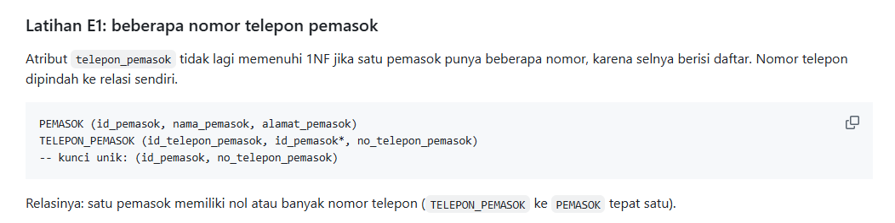

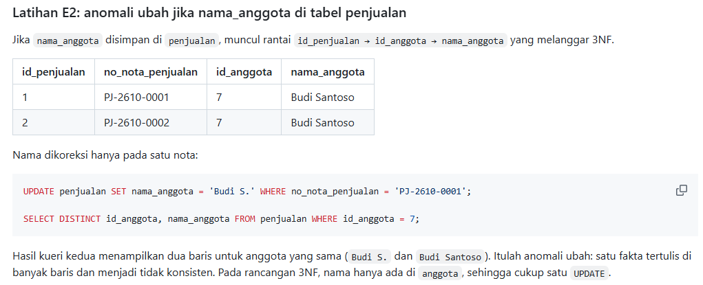

## 6. Tugas Mandiri: Milestone Proyek 4

Berkas: `p04_normalisasi_25430056.md` (proyek Yaya Library, database `perpus_056`).

| Ketentuan | Hasil |
|---|---|
| Dokumen sumber sebagai titik awal UNF | Slip Peminjaman dan Pengembalian Yaya Library |
| Dependensi fungsional dengan kode AB | FD1 sampai FD10 (termasuk FD3b), ditambah empat dependensi yang tidak berlaku |
| Tahapan 1NF, 2NF, 3NF | Tersedia, dengan anomali di setiap tahap |
| Pemeriksaan BCNF | Tujuh tabel diperiksa, seluruhnya BCNF |
| Keputusan nilai turunan | Tujuh nilai, beserta alasan |
| Pembaruan ERD | Satu perubahan: kolom `denda_detail_peminjaman` ditambahkan; tercatat di bagian 6 berkas |

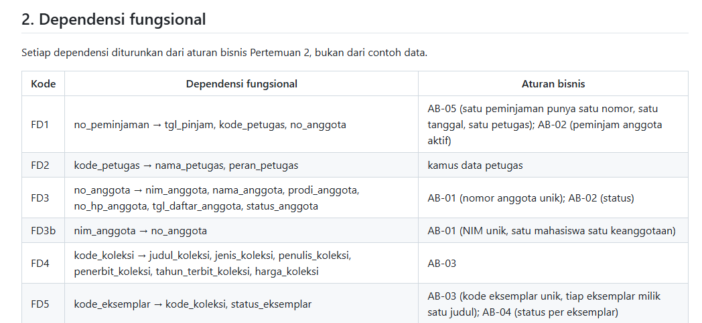

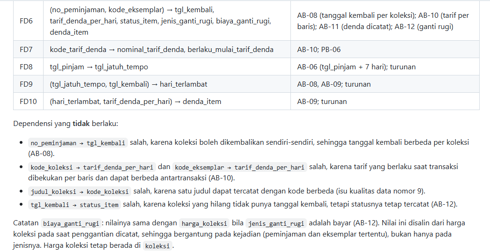

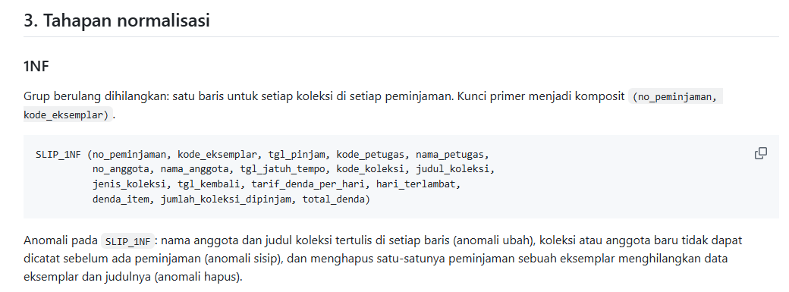

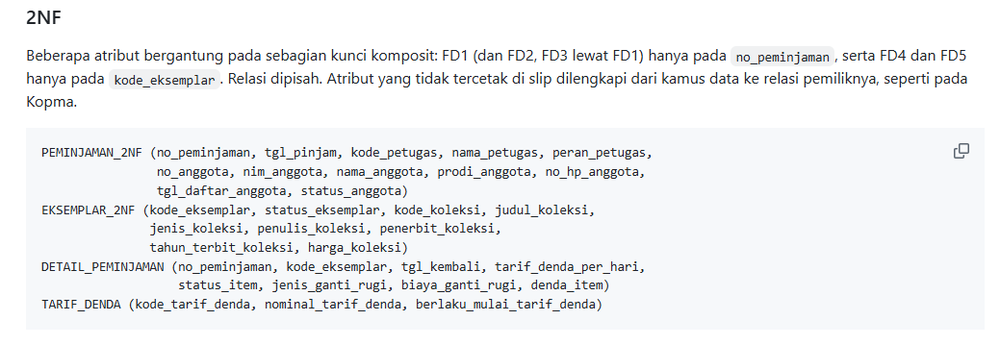

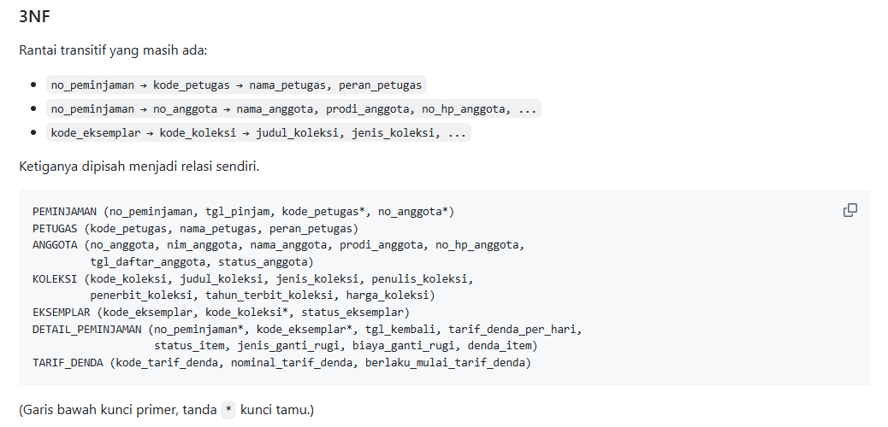

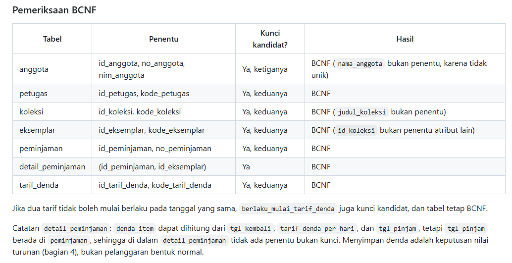

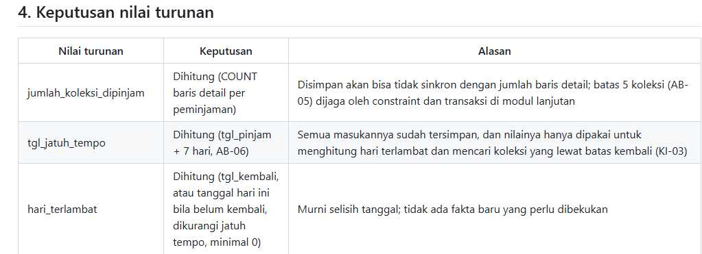

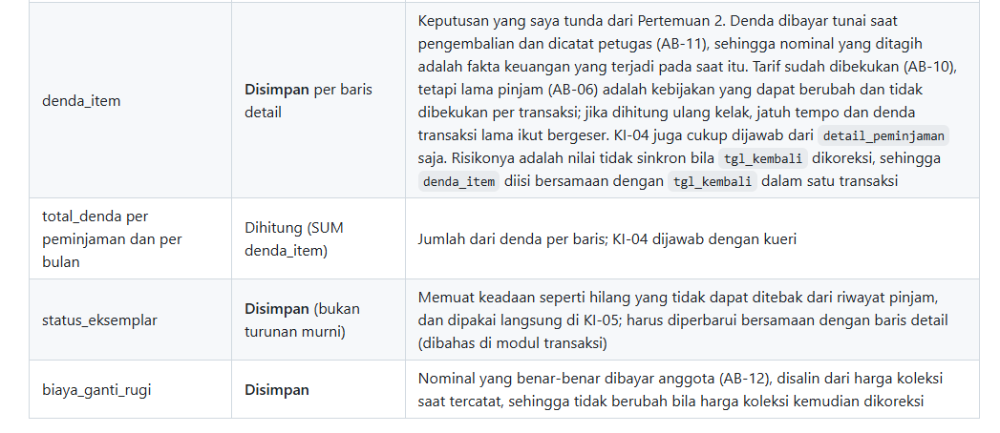

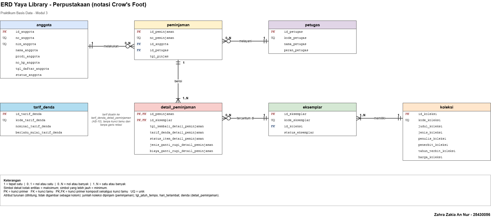

**Keputusan desain dan alasannya:**

1. **Tanggal kembali, tarif denda saat transaksi, status item, dan ganti rugi berada di `detail_peminjaman`.** Atribut itu bergantung pada pasangan (peminjaman, eksemplar), bukan pada salah satunya (FD6; AB-08, AB-10). Karena itu, `no_peminjaman → tgl_kembali` saya nyatakan tidak berlaku.
2. **Koleksi dan eksemplar tetap dua tabel.** `kode_eksemplar → kode_koleksi → judul_koleksi` adalah rantai transitif yang harus dipisah di 3NF.
3. **Denda per baris disimpan, total denda dihitung.** Ini menutup keputusan yang saya tunda dari Pertemuan 2. Denda dibayar tunai dan dicatat petugas (AB-11), sehingga nominal yang ditagih adalah fakta keuangan. Tarif sudah dibekukan (AB-10), tetapi lama pinjam 7 hari (AB-06) adalah kebijakan yang bisa berubah, sehingga menghitung ulang denda lama bisa menggeser hasilnya. Jatuh tempo dan hari terlambat tetap dihitung. Akibatnya ERD proyek diperbarui dengan satu kolom baru, `denda_detail_peminjaman`.
4. **`status_eksemplar` tetap disimpan.** Statusnya memuat keadaan seperti hilang atau rusak yang tidak dapat disimpulkan dari riwayat peminjaman, dan dipakai langsung di KI-05.

## 7. Pembahasan dan Kendala

Kendala pertama adalah menurunkan dependensi fungsional dari aturan bisnis, bukan dari contoh data. Saya mudah tergoda menulis `kode_barang → harga_satuan_detail_penjualan` karena harga pulpen di contoh selalu sama. AB-04 menunjukkan dependensi itu salah, sehingga harga harus berada pada kunci komposit nota dan barang.

Kendala kedua adalah menentukan di mana tarif denda proyek disimpan. Pada ERD Pertemuan 3 saya memutuskan tarif disalin ke baris detail (AB-10). Pada normalisasi, keputusan itu terbukti tidak melanggar 3NF, karena `tarif_denda_detail_peminjaman` ditentukan oleh pasangan (peminjaman, eksemplar), bukan oleh koleksi atau tabel tarif.

Kendala ketiga adalah memutuskan nilai turunan, terutama denda. Awalnya saya cenderung menghitungnya karena tarif dan tanggal kembali sudah dibekukan. Namun lama pinjam (AB-06) tidak dibekukan per transaksi, denda dibayar tunai dan dicatat petugas (AB-11), dan KI-04 dijawab dari tabel detail saja. Karena itu denda per baris saya simpan, sedangkan total denda dihitung. Pada Kopma, risiko diskon yang bergantung pada status anggota saya catat, dan potret nilai totalnya diserahkan ke tabel arsip.

Kendala keempat muncul saat memeriksa kunci Kopma. `no_faktur_pembelian` ternyata tidak unik sendirian karena dua pemasok bisa memakai nomor faktur yang sama, sehingga ERD Kopma Pertemuan 3 yang menandainya sebagai kunci alternatif perlu dikoreksi.

## 8. Kesimpulan

Normalisasi menguji ERD dari sisi data: setiap dependensi harus berasal dari aturan bisnis, dan setiap tabel harus bebas dari anomali ubah, sisip, dan hapus. Rancangan Kopma dan Yaya Library sama-sama sudah 3NF dan BCNF, dengan nilai turunan yang dihitung kecuali fakta yang tidak boleh bergeser atau tidak dapat ditebak (seperti uang yang diterima, denda yang dibayar, dan status eksemplar). Skema ini menjadi dasar skrip DDL di Pertemuan 5.

## 9. Pernyataan Penggunaan AI

| Butir | Isian |
|---|---|
| Alat yang dipakai | Claude (Anthropic) |
| Dipakai untuk | Menjelaskan konsep dan membuat draf dokumen normalisasi Kopma dan proyek (dependensi fungsional, tahapan normalisasi, pemeriksaan BCNF, keputusan nilai turunan) serta draf laporan ini, atas izin dosen |
| Bagian laporan terkait | Bagian 1 sampai 8 (draf awal), yang saya baca, periksa, dan ubah dengan bahasa sendiri |
| Yang dikerjakan sendiri | [SESUAIKAN: pemeriksaan dependensi terhadap aturan bisnis di dokumen Pertemuan 2, pencocokan dengan ERD, tangkapan layar, dan commit] |

## 10. Bukti Git

Tautan repositori: https://github.com/zahraazakiaannur-cmd/basisdata_25430056

| Hash commit | Pesan commit | Keterangan |
|---|---|---|
| | p04: normalisasi kopma | Berkas `p04_normalisasi_kopma_25430056.md` |
| | p04: normalisasi proyek | Berkas `p04_normalisasi_25430056.md` |
| | p04: laporan praktikum | Laporan dan gambar pendukung |

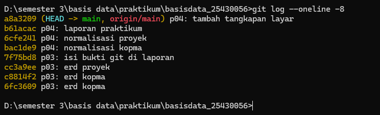

## Checklist

**Checklist umum**

- [ ] Identitas: nama, NIM, kelas, pertemuan, tanggal, nama asisten/dosen
- [ ] Tujuan: bahasa sendiri, maksimal 5 baris
- [ ] Ringkasan teori: pemahaman sendiri, maksimal setengah halaman
- [ ] Langkah percobaan (D): tangkapan layar langkah kunci dengan keterangan
- [ ] Titik Analisis: semua dijawab lengkap dengan alasan
- [ ] Latihan (E): hasil latihan beserta bukti
- [ ] Tugas Mandiri (F): berkas, bukti, dan penjelasan keputusan desain
- [ ] Pembahasan dan kendala
- [ ] Kesimpulan: dua sampai empat kalimat
- [ ] Pernyataan Penggunaan AI
- [ ] Bukti Git: tautan repositori dan hash commit berpesan `p04: ...`

**Checklist khusus Pertemuan 4**

- [ ] Berkas wajib: `p04_normalisasi_25430056.md` (proyek)
- [ ] Bukti tangkapan layar: tabel tahapan UNF, 1NF, 2NF, 3NF
- [ ] Analisis wajib: daftar dependensi fungsional; keputusan menyimpan atau menghitung nilai turunan beserta alasannya
