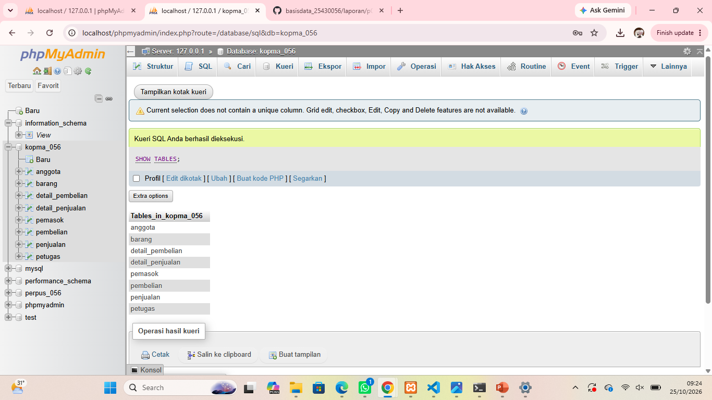
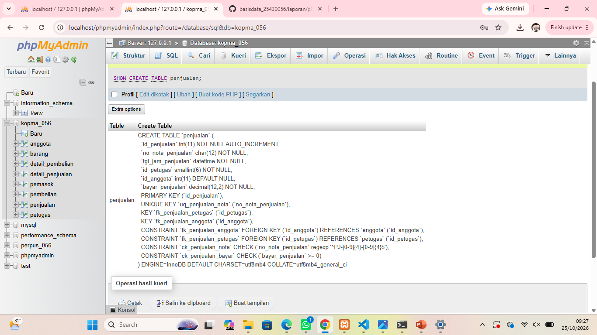
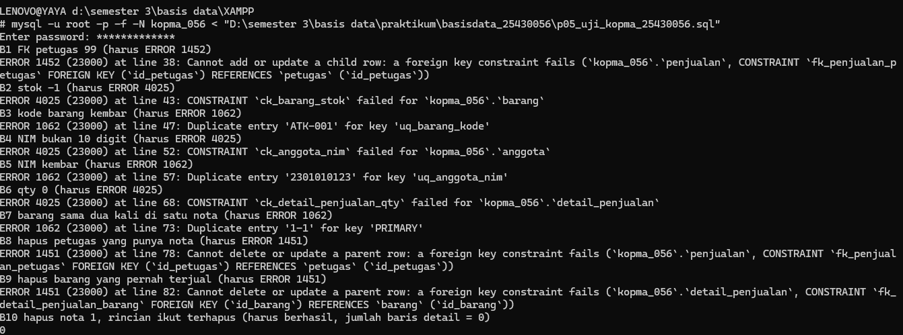
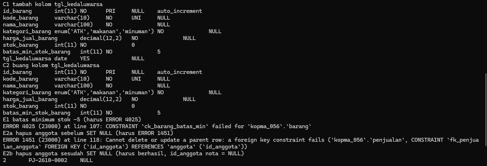
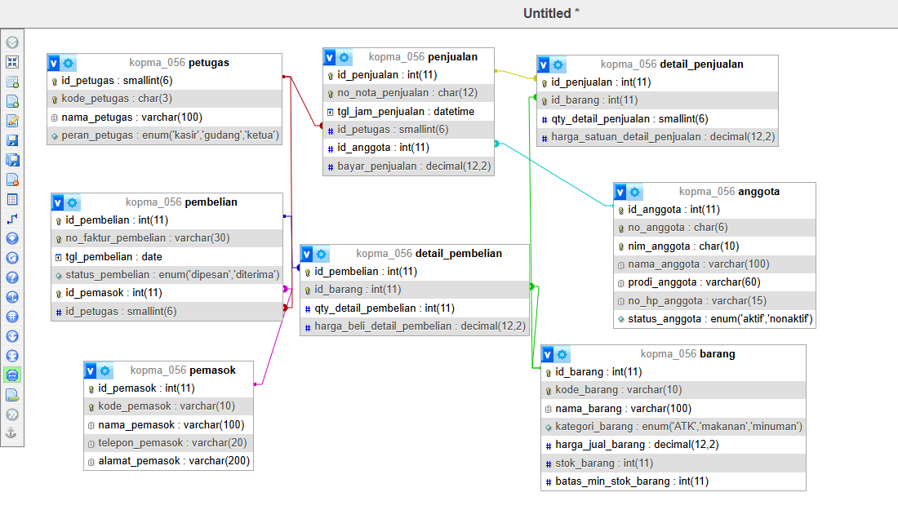
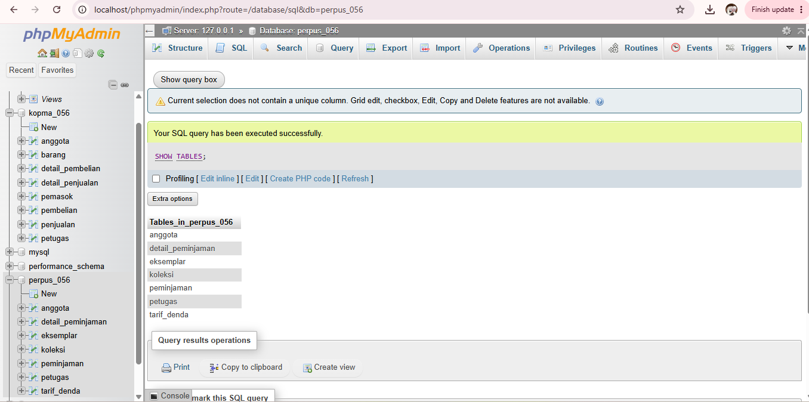
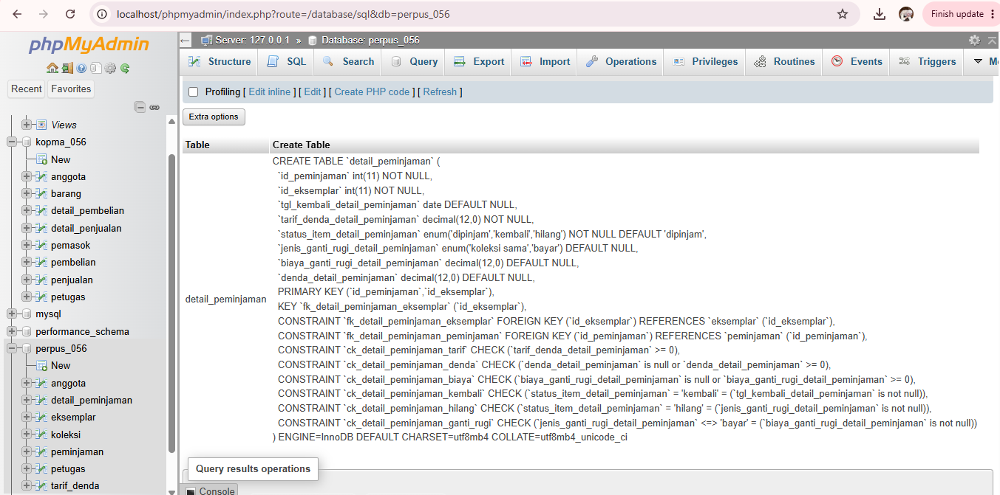
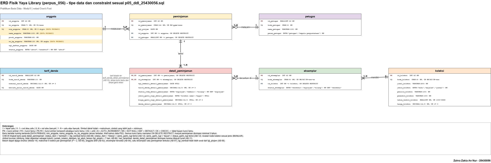
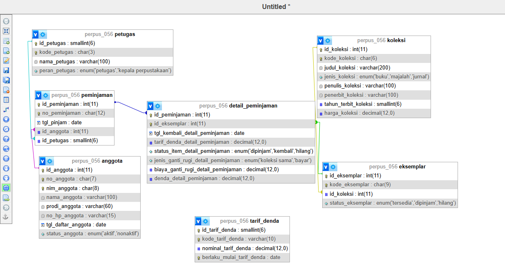
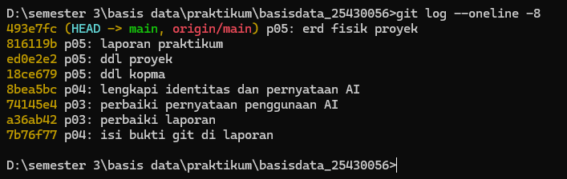

# Laporan Praktikum Basis Data - Pertemuan 05

**Nama:** Zahra Zakia An Nur  
**NPM:** 25430056  
**Kelas:** B  
**Tanggal:** [isi tanggal pelaksanaan]  

## 1. Tujuan Praktikum

Pada pertemuan ini saya mengubah skema relasional 3NF menjadi tabel sungguhan di MariaDB dengan CREATE TABLE, tipe data, dan constraint (PRIMARY KEY, FOREIGN KEY, UNIQUE, NOT NULL, DEFAULT, CHECK). Saya membuktikan constraint menolak data yang melanggar aturan bisnis, mengubah struktur dengan ALTER TABLE, lalu mencocokkan desain fisik dengan ERD.

## 2. Ringkasan Dasar Teori

DDL adalah bagian SQL untuk membuat, mengubah, dan menghapus struktur. Tipe data adalah keputusan desain: terlalu besar boros, terlalu kecil menolak data yang sah, dan uang memakai DECIMAL agar tepat. Constraint memindahkan aturan bisnis dari kebiasaan pengguna menjadi jaminan server. Sejak MariaDB 10.2, CHECK benar-benar ditegakkan.

Constraint hanya dapat menjaga aturan yang cukup dilihat dari satu baris atau dari kunci. Aturan yang membandingkan beberapa tabel atau menghitung banyak baris tidak dapat dijaga CHECK dan diselesaikan di transaksi (Modul 14). Tabel induk dibuat lebih dulu dan dihapus belakangan, karena kunci tamu menuntut induk ada. Aksi ON DELETE menentukan nasib baris anak: CASCADE menghapusnya ikut, RESTRICT menolak penghapusan induk.

## 3. Hasil Langkah Percobaan (Kopma)

Berkas: `p05_ddl_kopma_25430056.sql` (skema, dapat dijalankan ulang) dan `p05_uji_kopma_25430056.sql` (pembuktian constraint, ALTER, latihan).

- **D.1 dan D.2 Tabel induk dan transaksi.** Delapan tabel dibuat berurutan: petugas, anggota, barang, pemasok, penjualan, detail_penjualan, pembelian, detail_pembelian. Skrip diawali `DROP TABLE IF EXISTS` urutan terbalik, sehingga dapat diulang dari basis data kosong. Nama constraint memakai pola `pk_`, `fk_`, `uq_`, `ck_` ditambah nama tabel. Khusus kunci primer, MariaDB selalu menyimpannya dengan nama `PRIMARY`, sehingga nama `pk_` hanya terlihat di skrip dan tidak muncul di `SHOW CREATE TABLE`.
- **D.3 Pembuktian constraint.** Sepuluh percobaan ditolak server (lihat tabel di bawah).
- **D.4 ALTER dan perbandingan dengan ERD.** Kolom `tgl_kedaluwarsa` ditambahkan lalu dibuang tanpa membuat ulang tabel; desain fisik dibandingkan dengan ERD Pertemuan 3 di Designer.

### Pemetaan tipe data Kopma

| Elemen | Tipe | Alasan |
|---|---|---|
| id_petugas | SMALLINT AUTO_INCREMENT | Petugas hanya puluhan; tipe kecil cukup. Kunci tamu `id_petugas` di tabel lain memakai tipe yang sama persis |
| kode_petugas | CHAR(3) | Kode tetap tiga karakter (K01) |
| nim_anggota | CHAR(10) | Kode 10 digit, bukan angka untuk dihitung; CHECK memastikan hanya digit (AB-05) |
| no_anggota | CHAR(6) | Format tetap A-0457; CHECK `^A-[0-9]{4}$` |
| no_hp_anggota | VARCHAR(15) | Panjang bervariasi, diawali 0 sehingga tidak boleh INT; boleh NULL; CHECK hanya angka |
| status_anggota | ENUM('aktif','nonaktif') DEFAULT 'aktif' | Nilai terbatas dan diketahui (AB-02) |
| harga_jual_barang, harga_satuan_detail_penjualan, bayar_penjualan | DECIMAL(12,2) | Uang wajib tepat; FLOAT menimbulkan galat pembulatan |
| stok_barang | INT DEFAULT 0 | Bilangan bulat, dijaga CHECK >= 0 (AB-03) |
| qty_detail_penjualan | SMALLINT | Qty per baris tidak mungkin puluhan ribu; CHECK > 0 |
| no_nota_penjualan | CHAR(12) | Format tetap PJ-2609-0142; UNIQUE (AB-01) |
| tgl_jam_penjualan | DATETIME | Laporan harian dan jam sibuk membutuhkan jam (KI-01) |
| tgl_pembelian | DATE | Tanggal saja cukup |
| status_pembelian | ENUM('dipesan','diterima') | Pembelian bertahap: dipesan lalu diterima (AB-06) |
| no_faktur_pembelian | VARCHAR(30) | Nomor dari pemasok, formatnya tidak kita atur |

### Constraint dan aturan bisnis Kopma

| Constraint | Aturan bisnis |
|---|---|
| `uq_penjualan_nota`, `ck_penjualan_nota` | AB-01 nomor nota unik dan berformat |
| `ck_barang_stok` | AB-03 stok tidak boleh negatif |
| `ck_detail_penjualan_qty` | AB-03 qty harus lebih dari nol |
| `harga_satuan_detail_penjualan` NOT NULL di detail | AB-04 harga disalin per baris |
| `uq_anggota_nim`, `ck_anggota_nim` | AB-05 NIM unik dan 10 digit |
| `status_anggota` ENUM DEFAULT 'aktif' | AB-02 status hanya aktif atau nonaktif |
| `id_anggota` NULL di penjualan | AB-02 pembeli umum boleh tanpa anggota |
| `status_pembelian` ENUM DEFAULT 'dipesan' | AB-06 alur dipesan lalu diterima |
| `id_petugas` NULL di pembelian | AB-11 petugas penerima diisi saat barang diterima |
| `uq_pembelian_pemasok_faktur` | Nomor faktur hanya unik bersama pemasoknya (koreksi Pertemuan 4) |

### Bukti constraint menolak data yang melanggar aturan

| No | Percobaan | Galat | Constraint yang bekerja |
|---|---|---|---|
| B1 | nota dengan petugas 99 | 1452 | `fk_penjualan_petugas` |
| B2 | stok diubah menjadi -1 | 4025 | `ck_barang_stok` |
| B3 | kode barang kembar | 1062 | `uq_barang_kode` |
| B4 | NIM bukan 10 digit | 4025 | `ck_anggota_nim` |
| B5 | NIM kembar | 1062 | `uq_anggota_nim` |
| B6 | qty = 0 | 4025 | `ck_detail_penjualan_qty` |
| B7 | barang sama dua kali pada satu nota | 1062 | `pk_detail_penjualan` (tampil sebagai `PRIMARY`) |
| B8 | hapus petugas yang punya nota | 1451 | `fk_penjualan_petugas` |
| B9 | hapus barang yang pernah terjual | 1451 | `fk_detail_penjualan_barang` |
| B10 | hapus nota (rinciannya ikut terhapus) | berhasil | `fk_detail_penjualan_penjualan` (CASCADE) |

### Perbandingan desain fisik dengan ERD Pertemuan 3 (Kopma)

| No | Perbedaan | Penjelasan |
|---|---|---|
| 1 | Kolom `status_pembelian` ditambahkan | Tidak ada di ERD Pertemuan 3. Alur pembelian bertahap (AB-06) membutuhkan kolom ini untuk membedakan dipesan dan diterima |
| 2 | Kunci unik `pembelian`: pasangan (id_pemasok, no_faktur_pembelian) | ERD Pertemuan 3 menandai `no_faktur_pembelian` unik sendirian; normalisasi Pertemuan 4 mengoreksinya |
| 3 | Tipe data, ENUM, DEFAULT, dan CHECK | ERD konseptual tidak memuatnya; ERD fisik wajib sama persis dengan skrip DDL |
| 4 | ON DELETE CASCADE dari kepala nota dan faktur ke detailnya | Tidak tergambar di ERD konseptual |
| 5 | Nilai turunan tidak menjadi kolom | Sesuai ERD dan keputusan Pertemuan 4; hanya `bayar_penjualan` yang disimpan |

## 4. Jawaban Titik Analisis

**Titik Analisis 1.** `fk_detail_penjualan_penjualan` memakai ON DELETE CASCADE karena baris detail tidak bermakna tanpa nota induknya. Jika nota dibatalkan, rinciannya ikut hilang dan tidak ada baris yatim. Sebaliknya, `fk_detail_penjualan_barang` tanpa CASCADE (RESTRICT). Jika barang boleh dihapus beserta seluruh detailnya, setiap nota lama yang memuat barang itu kehilangan barisnya: omzet lama berkurang, harga historis (AB-04) hilang, dan nota bisa tersisa tanpa baris barang sehingga melanggar AB-01. Dengan RESTRICT, server menolak penghapusan (ERROR 1451).

**Titik Analisis 2.** Kode 1452 melindungi syarat setiap nota wajib punya petugas (`fk_penjualan_petugas`). Syarat ini berasal dari permintaan pengurus dan tidak punya kode AB sendiri di dokumen Pertemuan 2, sehingga sebaiknya ditambahkan sebagai aturan bisnis baru. Kode 4025 melindungi AB-03 (stok tidak boleh negatif). Kode 1062 pada kode barang melindungi keunikan kode barang (kamus data); pada NIM kode ini melindungi AB-05. Aturan Kopma yang belum dapat dijaga constraint apa pun: AB-01 minimal satu baris per nota (menyangkut banyak baris), AB-02 diskon hanya untuk anggota aktif (menyangkut status di tabel lain), penolakan penjualan bila qty melebihi stok pada AB-03 (membandingkan dua tabel), AB-04 harga nota sama dengan harga barang saat transaksi (membaca tabel barang), dan AB-06 pesanan dibuat bila stok di bawah minimum (proses, bukan struktur).

**Titik Analisis 3.** `DROP TABLE IF EXISTS` harus dimulai dari `detail_pembelian` dan `detail_penjualan` karena tabel anak memegang kunci tamu ke induknya. Jika petugas dihapus lebih dulu, server menolak karena `penjualan` masih merujuknya, dengan pesan `Cannot delete or update a parent row: a foreign key constraint fails` (ERROR 1451). Urutan benar adalah anak ke induk, kebalikan dari urutan membuat tabel.

## 5. Hasil Latihan dan Modifikasi

**Latihan E1: CHECK batas minimum stok.** Constraint `ck_barang_batas_min` (`batas_min_stok_barang >= 0`) ditambahkan dengan ALTER TABLE. Perintah `UPDATE barang SET batas_min_stok_barang = -5` ditolak dengan ERROR 4025.

**Latihan E2: ON DELETE SET NULL pada `fk_penjualan_anggota`.** Sebelum diubah, menghapus anggota yang punya nota ditolak (ERROR 1451). Setelah diubah, anggota terhapus dan `id_anggota` pada notanya menjadi NULL.

Perubahan ini sesuai AB-02 secara struktur, karena penjualan memang boleh tanpa anggota. Dari sisi UU PDP, SET NULL membantu menghapus data pribadi anggota sambil mempertahankan catatan transaksi tanpa identitas. Namun ada konsekuensi: diskon 5% dihitung dari anggota aktif dan total nota tidak disimpan. Nota lama yang kehilangan anggotanya akan terhitung ulang tanpa diskon, sehingga totalnya berbeda dari `bayar_penjualan`. Risiko ini sama dengan yang saya catat di Pertemuan 4. Untuk operasional, saya lebih memilih tetap RESTRICT dan menonaktifkan anggota. SET NULL baru aman bila total nota dibekukan di tabel arsip.

## 6. Tugas Mandiri: Milestone Proyek 5

Berkas: `p05_ddl_25430056.sql` (proyek Yaya Library, database `perpus_056`) dan `p05_erd_fisik_25430056.drawio` beserta PNG-nya.

### Pemetaan tipe data proyek

| Elemen | Tipe | Alasan |
|---|---|---|
| no_anggota | CHAR(7) | Format tetap YL-0123; CHECK `^YL-[0-9]{4}$` (AB-01) |
| nim_anggota | CHAR(8) | 8 digit angka, bukan untuk dihitung; CHECK `^[0-9]{8}$` (AB-01) |
| no_hp_anggota | VARCHAR(15) NOT NULL | Wajib diisi dan hanya angka (isu kualitas 10); diawali 0 sehingga bukan INT; data pribadi |
| status_anggota | ENUM('aktif','nonaktif') DEFAULT 'aktif' | Aktif sejak mendaftar (AB-02) |
| tgl_daftar_anggota, tgl_pinjam, tgl_kembali_detail_peminjaman | DATE | Tanggal saja cukup; slip tidak mencatat jam |
| peran_petugas | ENUM('petugas','kepala perpustakaan') | Hanya dua peran (kamus data) |
| kode_koleksi | CHAR(6) | Format tetap BK-001; CHECK awalan BK/MJ/JR sesuai jenis |
| kode_eksemplar | CHAR(9) | Format tetap BK-001-02; UNIQUE (AB-03) |
| jenis_koleksi | ENUM('buku','majalah','jurnal') | Nilai terbatas (AB-03) |
| tahun_terbit_koleksi | SMALLINT | Empat digit; CHECK 1000 sampai 9999 |
| harga_koleksi, tarif_denda_detail_peminjaman, nominal_tarif_denda, biaya_ganti_rugi_detail_peminjaman, denda_detail_peminjaman | DECIMAL(12,0) | Uang tepat; kamus data menetapkan rupiah bilangan bulat, sehingga tanpa sen |
| status_eksemplar | ENUM('tersedia','dipinjam','hilang') DEFAULT 'tersedia' | AB-04 |
| status_item_detail_peminjaman | ENUM('dipinjam','kembali','hilang') DEFAULT 'dipinjam' | Kamus data |
| jenis_ganti_rugi_detail_peminjaman | ENUM('koleksi sama','bayar') NULL | Terisi hanya bila hilang (AB-12) |
| no_peminjaman | CHAR(12) | Format tetap PM-2610-0007; UNIQUE (AB-05) |

### Constraint dan aturan bisnis proyek

| Constraint | Aturan bisnis |
|---|---|
| `uq_anggota_no`, `ck_anggota_no`, `uq_anggota_nim`, `ck_anggota_nim` | AB-01 |
| `status_anggota` ENUM DEFAULT 'aktif' | AB-02 |
| `uq_koleksi_kode`, `ck_koleksi_kode`, `ck_koleksi_awalan`, `jenis_koleksi` ENUM | AB-03 |
| `uq_eksemplar_kode`, `ck_eksemplar_kode`, `fk_eksemplar_koleksi` | AB-03 |
| `status_eksemplar` ENUM DEFAULT 'tersedia' | AB-04 |
| `uq_peminjaman_no`, `ck_peminjaman_no`, `fk_peminjaman_petugas` (NOT NULL) | AB-05 |
| `fk_peminjaman_anggota` (NOT NULL) | AB-02, AB-05 |
| `ck_detail_peminjaman_kembali` (status kembali sama dengan tanggal kembali terisi) | AB-08 |
| `ck_detail_peminjaman_denda`, `ck_detail_peminjaman_tarif` | AB-09, AB-10 |
| `tarif_denda_detail_peminjaman` NOT NULL, `uq_tarif_denda_mulai` | AB-10 |
| `ck_detail_peminjaman_hilang`, `ck_detail_peminjaman_ganti_rugi` | AB-12 |
| `ck_koleksi_harga`, `ck_detail_peminjaman_biaya` | AB-12 |

Semua kunci tamu memakai ON DELETE RESTRICT karena riwayat peminjaman disimpan minimal 5 tahun dan matriks CRUD tidak memuat penghapusan. Koleksi yang hilang pun tetap tercatat.

### Analisis aturan batas P + 2

Parameter personal P = 3, sehingga batas maksimal item per transaksi adalah P + 2 = 5 koleksi (AB-05). Aturan ini menyangkut **jumlah baris** `detail_peminjaman` untuk satu `id_peminjaman`, bukan nilai pada satu baris. CHECK hanya melihat satu baris, sehingga tidak dapat menjaganya. Aturan ini ditandai untuk Modul 14 (transaksi atau pemicu yang menghitung baris sebelum menambah). Nilai berbasis P pada satu baris hanyalah tarif denda Rp3.000, yang merupakan data awal (Pertemuan 6), dijaga dengan CHECK `nominal_tarif_denda >= 0`.

Aturan lain yang tidak dapat dijaga struktur: AB-02 dan AB-04 (menyangkut status di tabel lain), AB-07 (satu eksemplar pada dua peminjaman terbuka, melibatkan banyak baris), AB-08 bagian tanggal kembali tidak lebih awal dari tanggal pinjam (tanggal pinjam ada di tabel `peminjaman`), dan AB-09 (denda dihitung lintas tabel). Aturan yang bergantung waktu (tanggal tidak di masa depan, tahun terbit tidak melebihi tahun berjalan) sengaja tidak ditulis sebagai CHECK karena nilainya berubah mengikuti waktu, dan diperiksa aplikasi atau pemicu.

### ERD fisik

ERD fisik memuat tipe data persis seperti DDL, constraint (AI, UNIQUE, NOT NULL, DEFAULT, CHECK, ENUM), tujuan dan aksi ON DELETE tiap kunci tamu, tanda data pribadi, dan hanya satu nilai turunan yang disimpan (`denda_detail_peminjaman`).

### Perbandingan Designer dengan ERD proyek

| No | Perbedaan | Penjelasan |
|---|---|---|
| 1 | `berlaku_mulai_tarif_denda` UNIQUE | Tidak ada di ERD konseptual. Keputusan baru: dua tarif tidak boleh berlaku mulai tanggal yang sama, mendukung tarif baru menjadi baris baru (AB-10) |
| 2 | Tipe data, ENUM, DEFAULT, CHECK | ERD konseptual tidak memuatnya |
| 3 | `no_hp_anggota` NOT NULL | Kamus data menyatakan wajib diisi |
| 4 | Semua kunci tamu ON DELETE RESTRICT | Mengikuti retensi 5 tahun; tidak tergambar di ERD konseptual |
| 5 | `tarif_denda` tidak punya garis ke `detail_peminjaman` | Sama dengan ERD: tarif disalin ke baris detail (AB-10) |

### Keputusan desain dan alasannya

1. **Ganti rugi dijaga tiga CHECK tingkat baris.** Status `kembali` harus sama dengan tanggal kembali terisi, jenis ganti rugi terisi hanya bila status `hilang`, dan biaya terisi hanya bila jenisnya `bayar`. Ketiganya menutup isu kualitas data 11 tanpa pemicu.
2. **Semua kunci tamu RESTRICT, bukan CASCADE.** Tidak ada proses yang menghapus peminjaman (matriks CRUD tanpa D), sehingga CASCADE justru berbahaya karena dapat menghapus riwayat denda.
3. **`harga_koleksi` dan uang lain memakai DECIMAL(12,0).** Kamus data menetapkan rupiah bilangan bulat, dan DECIMAL tetap tepat tanpa galat pembulatan.
4. **Aturan lintas baris dan lintas tabel tidak dipaksakan lewat CHECK.** Aturan itu ditandai di komentar skrip untuk Modul 14.

## 7. Pembahasan dan Kendala

Kendala pertama adalah memahami bahwa CHECK hanya melihat satu baris. Awalnya saya ingin menulis batas 5 koleksi per transaksi sebagai CHECK, tetapi aturan itu menghitung banyak baris, sehingga hanya bisa dijaga di Modul 14. Hal serupa berlaku pada tanggal kembali yang tidak boleh lebih awal dari tanggal pinjam, karena tanggal pinjam ada di tabel lain.

Kendala kedua adalah logika NULL pada CHECK. Sebuah CHECK yang menghasilkan NULL dianggap lolos, sehingga kondisi seperti "jenis ganti rugi terisi hanya bila hilang" bisa meloloskan data salah jika ditulis dengan perbandingan biasa. Saya menulisnya sebagai perbandingan dua nilai benar atau salah, dan memakai `<=>` untuk membandingkan nilai yang boleh NULL.

Kendala ketiga adalah memilih ON DELETE. Pola Kopma memakai CASCADE untuk kepala dan detail transaksi, tetapi pada Yaya Library tidak ada proses yang menghapus peminjaman dan riwayat harus disimpan 5 tahun, sehingga saya memilih RESTRICT.

Kendala keempat adalah kolom yang berubah antara ERD dan DDL. Kolom `status_pembelian` dan kunci unik pasangan pada tabel `pembelian` tidak ada di ERD Pertemuan 3, sehingga saya mencatatnya di tabel perbandingan.

## 8. Kesimpulan

Constraint mengubah aturan bisnis menjadi jaminan server, tetapi hanya untuk aturan yang cukup dilihat dari satu baris atau dari kunci. Aturan lintas baris dan lintas tabel, seperti batas 5 koleksi per peminjaman, harus diselesaikan di Modul 14. Skema Kopma dan Yaya Library kini dapat dijalankan ulang dari basis data kosong dan cocok dengan ERD fisik yang saya gambar.

## 9. Pernyataan Penggunaan AI

| Butir | Isian |
|---|---|
| Alat yang dipakai | Claude (Anthropic) |
| Dipakai untuk | Membuat draf skrip DDL Kopma dan proyek, skrip pembuktian constraint, ERD fisik, serta draf laporan ini, atas izin dosen |
| Bagian laporan terkait | Bagian 1 sampai 8 (draf awal), yang saya baca, periksa, dan ubah dengan bahasa sendiri |
| Yang dikerjakan sendiri | [SESUAIKAN: menjalankan skrip di MariaDB, mengambil tangkapan layar galat, membandingkan Designer dengan ERD, memeriksa constraint terhadap AB, dan commit] |

## 10. Bukti Git

Tautan repositori: https://github.com/zahraazakiaannur-cmd/basisdata_25430056

| Hash commit | Pesan commit | Keterangan |
|---|---|---|
| | p05: ddl kopma | `p05_ddl_kopma_25430056.sql` dan `p05_uji_kopma_25430056.sql` |
| | p05: ddl proyek | `p05_ddl_25430056.sql` |
| | p05: erd fisik proyek | `p05_erd_fisik_25430056.drawio` dan PNG |
| | p05: laporan praktikum | Laporan dan gambar pendukung |

## Checklist

**Checklist umum**

- [ ] Identitas: nama, NIM, kelas, pertemuan, tanggal, nama asisten/dosen
- [ ] Tujuan: bahasa sendiri, maksimal 5 baris
- [ ] Ringkasan teori: pemahaman sendiri, maksimal setengah halaman
- [ ] Langkah percobaan (D): tangkapan layar langkah kunci dengan keterangan
- [ ] Titik Analisis: semua dijawab lengkap dengan alasan
- [ ] Latihan (E): hasil latihan beserta bukti
- [ ] Tugas Mandiri (F): berkas, bukti, dan penjelasan keputusan desain
- [ ] Pembahasan dan kendala
- [ ] Kesimpulan: dua sampai empat kalimat
- [ ] Pernyataan Penggunaan AI
- [ ] Bukti Git: tautan repositori dan hash commit berpesan `p05: ...`

**Checklist khusus Pertemuan 5**

- [ ] Berkas wajib: `p05_ddl_25430056.sql` (dapat dijalankan ulang) dan ERD fisik `p05_erd_fisik_25430056`
- [ ] Bukti tangkapan layar: SHOW CREATE TABLE tabel utama; galat saat constraint dilanggar (FK, UNIQUE, CHECK)
- [ ] Analisis wajib: alasan pemilihan tipe data dan constraint; kaitan constraint dengan AB-xx