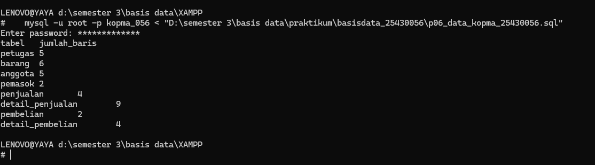
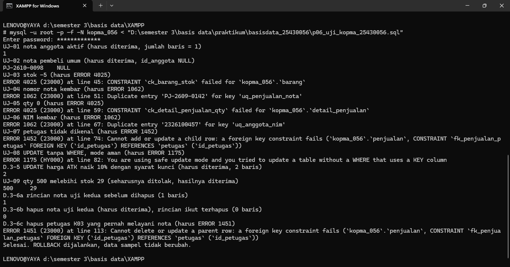
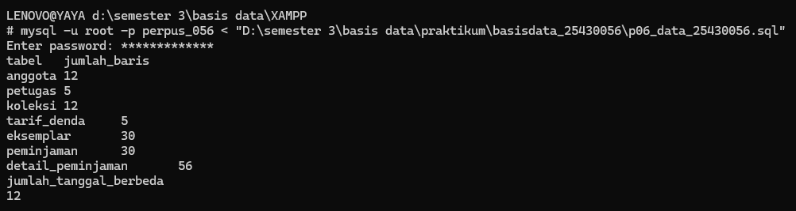
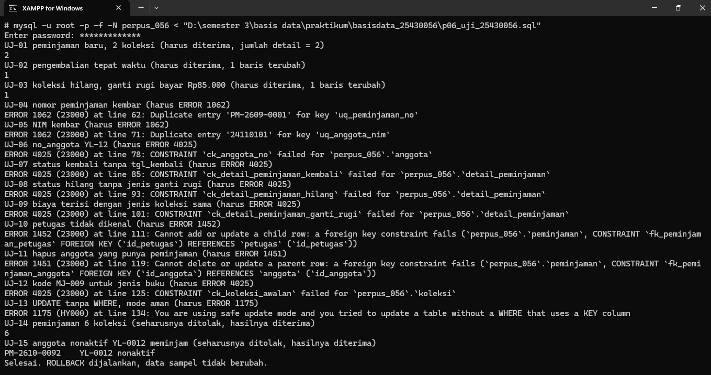
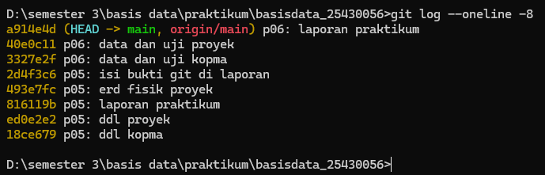

# Laporan Praktikum Basis Data - Pertemuan 06

**Nama:** Zahra Zakia An Nur  
**NPM:** 25430056  
**Kelas:** B  
**Tanggal:** 11 november 2026  

## 1. Tujuan Praktikum

Pada pertemuan ini saya mengisi tabel yang dibuat di Modul 5 dengan INSERT satu baris, banyak baris, dan INSERT ... SELECT, lalu mengubah dan menghapus data dengan aman memakai `sql_safe_updates`. Saya juga menyusun skenario uji positif dan negatif beserta hasil nyatanya, dan menyiapkan data sampel proyek yang dapat dibangun ulang dari skrip.

## 2. Ringkasan Dasar Teori

DML terdiri atas INSERT, UPDATE, DELETE, dan SELECT. Karena ada kunci tamu, pengisian mengikuti urutan induk dulu lalu anak, dan penghapusan sebaliknya, kecuali relasi yang memakai ON DELETE CASCADE. INSERT ... SELECT dengan kode alami lebih aman daripada menebak nilai AUTO_INCREMENT atau mengetik harga manual.

UPDATE atau DELETE tanpa WHERE mengenai semua baris tanpa galat. Mode `sql_safe_updates` membuat server menolak perintah seperti itu kecuali syaratnya memakai kolom kunci. Basis data juga harus diuji: uji positif memastikan data benar diterima, uji negatif memastikan data salah ditolak dengan galat yang tepat, dan setiap uji dicatat dengan format tetap agar dapat diulang.

## 3. Hasil Langkah Percobaan (Kopma)

Berkas: `p06_data_kopma_25430056.sql`, `p06_uji_kopma_25430056.sql`, `p06_uji_kopma_25430056.md`, dan `p06_latihan_kopma_25430056.sql`.

- **D.1 Data induk.** Lima petugas, enam barang, lima anggota (dua nonaktif), dan dua pemasok diisi dengan INSERT banyak baris.
- **D.2 Nota penjualan.** Empat nota pada tiga tanggal berbeda, termasuk nota contoh PJ-2609-0142 (jumlah Rp29.000, diskon Rp1.450, total Rp27.550). Baris detail diisi dengan INSERT ... SELECT sehingga harga satuan disalin dari harga jual saat itu (AB-04), lalu stok dikurangi dengan UPDATE ... WHERE kode_barang. Dua faktur pembelian ikut dicatat.
- **D.3 Ubah dan hapus aman.** UPDATE tanpa WHERE ditolak (ERROR 1175), sedangkan UPDATE dengan syarat kolom kunci diterima. Nota uji kedua dihapus dan rinciannya ikut terhapus (CASCADE), sedangkan menghapus petugas K03 ditolak (ERROR 1451).
- **D.4 Skenario uji.** Sembilan skenario (UJ-01 sampai UJ-09) tercatat di `p06_uji_kopma_25430056.md`, delapan LULUS dan satu GAGAL.

### Jumlah baris per tabel Kopma

| Tabel | Jumlah baris |
|---|---|
| petugas | 5 |
| barang | 6 |
| anggota | 5 |
| pemasok | 2 |
| penjualan | 4 |
| detail_penjualan | 9 |
| pembelian | 2 |
| detail_pembelian | 4 |



### Hasil skenario uji Kopma

| Kode | Masukan | Harapan | Hasil nyata | Status |
|---|---|---|---|---|
| UJ-01 | Nota baru dengan anggota aktif | Diterima | Diterima | LULUS |
| UJ-02 | Nota tanpa anggota | Diterima, id_anggota NULL | Diterima, id_anggota NULL | LULUS |
| UJ-03 | Stok diubah menjadi -5 | ERROR 4025 | ERROR 4025 (`ck_barang_stok`) | LULUS |
| UJ-04 | Nomor nota sudah ada | ERROR 1062 | ERROR 1062 (`uq_penjualan_nota`) | LULUS |
| UJ-05 | Detail dengan qty 0 | ERROR 4025 | ERROR 4025 (`ck_detail_penjualan_qty`) | LULUS |
| UJ-06 | Anggota dengan NIM kembar | ERROR 1062 | ERROR 1062 (`uq_anggota_nim`) | LULUS |
| UJ-07 | Petugas tidak dikenal | ERROR 1452 | ERROR 1452 (`fk_penjualan_petugas`) | LULUS |
| UJ-08 | UPDATE tanpa WHERE di mode aman | ERROR 1175 | ERROR 1175 | LULUS |
| UJ-09 | Detail qty 500 padahal stok 29 | Seharusnya ditolak | Diterima | **GAGAL** |

Uraian lengkap setiap skenario ada di `p06_uji_kopma_25430056.md`.



## 4. Jawaban Titik Analisis

**Titik Analisis 1.** INSERT ... SELECT mengambil harga langsung dari tabel `barang`, sehingga harga yang tercatat selalu sama dengan harga jual pada saat transaksi dan tidak ada salah ketik angka. Setelah harga pulpen naik menjadi Rp4.500, nota PJ-2609-0142 tidak ikut berubah, karena `harga_satuan_detail_penjualan` adalah salinan nilai di baris detail, bukan rujukan ke harga barang (AB-04). Kenaikan harga hanya memengaruhi nota baru. Latihan E2 membuktikannya: setelah harga makanan naik, harga roti pada nota lama tetap Rp5.000.

**Titik Analisis 2.** Menghapus nota ikut menghapus rinciannya karena `fk_detail_penjualan_penjualan` didefinisikan ON DELETE CASCADE: baris detail tidak bermakna tanpa nota induknya. Menghapus petugas ditolak karena `fk_penjualan_petugas` memakai aksi bawaan RESTRICT, sehingga petugas yang namanya masih tercantum di nota tidak boleh hilang. Jika seorang kasir berhenti bekerja, datanya tidak dihapus, karena riwayat nota membutuhkannya. Cara yang benar adalah menandainya tidak aktif. Tabel `petugas` Kopma belum punya kolom status, sehingga perlu ditambahkan sebagai perubahan desain (misalnya `status_petugas`), dan akses akunnya dicabut tanpa menghapus barisnya.

**Titik Analisis 3.** Uji yang saya perkirakan gagal adalah UJ-09: detail penjualan dengan qty 500 padahal stok hanya 29. Constraint `ck_barang_stok` hanya memeriksa `stok_barang >= 0` pada satu baris tabel `barang`. Qty berada di tabel `detail_penjualan`, sehingga saat INSERT detail server tidak membandingkannya dengan stok barang, dan baris detail tetap diterima. Penolakan baru terjadi kalau stok dikurangi qty, yaitu saat UPDATE membuat stok negatif, tetapi itu perintah terpisah. Karena itu aturan penjualan tidak boleh melebihi stok harus dijaga oleh transaksi yang memeriksa stok sebelum menerima baris (Modul 14).

## 5. Hasil Latihan dan Modifikasi

**Latihan E1: pengarsipan anggota nonaktif.** Tabel `anggota` Kopma belum punya tanggal daftar, sehingga kolom `tgl_daftar_anggota` ditambahkan dengan ALTER TABLE sebagai perubahan desain. Tabel `anggota_arsip` dibuat dengan `CREATE TABLE ... LIKE`, lalu anggota nonaktif yang mendaftar sebelum 2025 dipindahkan dengan INSERT ... SELECT dan dihapus dari tabel asal. Anggota yang masih punya penjualan dikecualikan dengan `id_anggota NOT IN (SELECT id_anggota FROM penjualan WHERE id_anggota IS NOT NULL)`. Syarat `IS NOT NULL` penting karena nota pembeli umum memiliki id_anggota NULL, dan satu NULL dalam daftar NOT IN membuat seluruh syarat tidak benar. Hasil: A-0460 (Maya Anggraini) berpindah ke arsip, sedangkan A-0461 (Teguh Wibisono, nonaktif dan mendaftar 2024, tetapi punya nota PJ-2609-0150) tetap berada di tabel `anggota`.

**Latihan E2: kenaikan harga makanan 5%.**

```sql
UPDATE barang
SET harga_jual_barang = ROUND(harga_jual_barang * 1.05, -2)
WHERE kategori_barang = 'makanan' AND id_barang > 0;
```

Hasil: roti cokelat naik dari Rp5.000 menjadi Rp5.300 dan wafer cokelat dari Rp3.500 menjadi Rp3.700. Syarat `id_barang > 0` diperlukan karena mode aman menolak UPDATE yang tidak memakai kolom kunci.

## 6. Tugas Mandiri: Milestone Proyek 6

Berkas: `p06_data_25430056.sql` dan `p06_uji_25430056.md` (proyek Yaya Library, database `perpus_056`), ditambah `p06_uji_25430056.sql` sebagai skrip pelaksana uji.

| Ketentuan | Hasil |
|---|---|
| Setiap tabel induk minimal 5 baris | anggota 12, petugas 5, koleksi 12, tarif_denda 5 |
| Tabel transaksi minimal 10 x P = 30 baris | 30 peminjaman (P = 3), dengan 56 baris detail dan 30 eksemplar |
| Minimal tiga tanggal berbeda | 12 tanggal berbeda (2026-09-07 sampai 2026-10-23) |
| Minimal 10 skenario uji, sedikitnya 5 negatif | 15 skenario: 3 positif, 10 negatif, 2 gagal |
| Setiap uji merujuk AB-xx atau nama constraint | Ya, kolom aturan di setiap baris |
| Satu uji gagal sebagai utang desain | UJ-14 dan UJ-15, dicatat untuk Modul 14 |
| Skrip DDL dan data dapat diulang dari basis data kosong | Ya (DDL Modul 5 lalu data Modul 6) |

### Jumlah baris per tabel proyek

| Tabel | Jumlah baris |
|---|---|
| anggota | 12 |
| petugas | 5 |
| koleksi | 12 |
| tarif_denda | 5 |
| eksemplar | 30 |
| peminjaman | 30 |
| detail_peminjaman | 56 |



### Hasil skenario uji proyek

| Kode | Jenis | Ringkasan masukan | Hasil nyata | Status |
|---|---|---|---|---|
| UJ-01 | Positif | Peminjaman baru anggota aktif, 2 koleksi | Diterima, 2 detail | LULUS |
| UJ-02 | Positif | Pengembalian tepat waktu, denda 0 | Diterima | LULUS |
| UJ-03 | Positif | Koleksi hilang, ganti rugi bayar Rp85.000 | Diterima | LULUS |
| UJ-04 | Negatif | Nomor peminjaman kembar | ERROR 1062 (`uq_peminjaman_no`) | LULUS |
| UJ-05 | Negatif | NIM anggota kembar | ERROR 1062 (`uq_anggota_nim`) | LULUS |
| UJ-06 | Negatif | Nomor anggota `YL-12` | ERROR 4025 (`ck_anggota_no`) | LULUS |
| UJ-07 | Negatif | Status kembali tanpa tanggal kembali | ERROR 4025 (`ck_detail_peminjaman_kembali`) | LULUS |
| UJ-08 | Negatif | Status hilang tanpa jenis ganti rugi | ERROR 4025 (`ck_detail_peminjaman_hilang`) | LULUS |
| UJ-09 | Negatif | Biaya terisi dengan jenis koleksi sama | ERROR 4025 (`ck_detail_peminjaman_ganti_rugi`) | LULUS |
| UJ-10 | Negatif | Petugas tidak dikenal | ERROR 1452 (`fk_peminjaman_petugas`) | LULUS |
| UJ-11 | Negatif | Hapus anggota yang punya peminjaman | ERROR 1451 (`fk_peminjaman_anggota`) | LULUS |
| UJ-12 | Negatif | Kode MJ-009 untuk jenis buku | ERROR 4025 (`ck_koleksi_awalan`) | LULUS |
| UJ-13 | Negatif | UPDATE tanpa WHERE di mode aman | ERROR 1175 | LULUS |
| UJ-14 | Gagal | Peminjaman 6 koleksi (batas 5) | Diterima, seharusnya ditolak | **GAGAL** |
| UJ-15 | Gagal | Anggota nonaktif meminjam | Diterima, seharusnya ditolak | **GAGAL** |

Uraian lengkap, termasuk pesan galat dan rencana perbaikan, ada di `p06_uji_25430056.md`.



### Keputusan desain data dan alasannya

1. **Data berbasis P = 3.** Jumlah peminjaman 10 x 3 = 30, tarif denda berlaku Rp3.000 per hari (P ribu), dan batas koleksi per transaksi 3 + 2 = 5 (AB-05).
2. **Tarif denda memiliki riwayat lima baris** (2022 sampai 2026, Rp1.000 sampai Rp3.000), sehingga tabel induk ini memenuhi minimal lima baris sekaligus mendukung AB-10: tarif yang berlaku saat transaksi disalin ke baris detail.
3. **Riwayat peminjaman memuat semua keadaan.** Ada koleksi yang dikembalikan tepat waktu, terlambat (dengan denda hasil hari terlambat x Rp3.000), masih dipinjam, dan hilang (satu diganti dengan membayar, satu diganti koleksi sama). Dengan begitu kueri Pertemuan 7 sampai 15 punya bahan untuk semua kebutuhan informasi.
4. **Delapan eksemplar dicadangkan** dan tidak pernah dipinjam di data sampel, supaya skenario uji tidak bentrok dengan data.
5. **Status eksemplar mengikuti riwayat.** Eksemplar yang masih dipinjam berstatus `dipinjam` dan yang hilang berstatus `hilang`.
6. **Kunci tamu diambil lewat kode alami** (subkueri), bukan menebak nilai AUTO_INCREMENT, sehingga skrip menghasilkan data yang sama setiap dijalankan ulang.
7. **Uji dibungkus transaksi dan ROLLBACK,** sehingga jumlah baris data sampel tidak berubah setelah uji.

## 7. Pembahasan dan Kendala

Kendala pertama adalah membuat skrip data yang dapat dijalankan ulang. Nilai AUTO_INCREMENT tidak kembali ke 1 setelah DELETE, sehingga menebak nilai id membuat INSERT tabel anak gagal dengan ERROR 1452. Karena itu saya selalu membangun ulang dari DDL dan mengambil kunci tamu lewat kode alami dengan subkueri.

Kendala kedua adalah menjaga aturan konsistensi antarkolom pada data sampel proyek. Setiap baris detail harus lolos tiga CHECK (status kembali dengan tanggal kembali, hilang dengan jenis ganti rugi, bayar dengan biaya). Saya menulis data bersama pemeriksaan aturan yang sama agar INSERT besar tidak ditolak di tengah jalan, dan memastikan tidak ada eksemplar yang dipinjam bersamaan.

Kendala ketiga adalah memahami bahwa constraint tidak menjaga semuanya. Batas lima koleksi per peminjaman dan anggota harus aktif ternyata diterima server (UJ-14 dan UJ-15), karena aturannya menghitung banyak baris atau membaca tabel lain. Dua hal itu saya catat sebagai utang desain untuk Modul 14, bukan dianggap kesalahan skrip.

Kendala keempat adalah pengarsipan anggota di Latihan E1. Kolom tanggal daftar belum ada di Kopma, sehingga saya menambahkannya dengan ALTER TABLE. Syarat `NOT IN` juga harus dibatasi dengan `IS NOT NULL`, karena nota pembeli umum memiliki id_anggota NULL.

## 8. Kesimpulan

Mengisi data harus mengikuti urutan induk ke anak, dan UPDATE atau DELETE selalu memerlukan syarat yang tepat, dibantu mode aman. Skenario uji tertulis membuktikan constraint bekerja untuk data salah yang bisa dilihat dari satu baris atau dari kunci, tetapi aturan lintas baris dan lintas tabel tetap harus diselesaikan di Modul 14. Data sampel Kopma dan Yaya Library kini dapat dibangun ulang dari DDL dan skrip data, dan menjadi bahan seluruh kueri berikutnya.

## 9. Pernyataan Penggunaan AI

| Butir | Isian |
|---|---|
| Alat yang dipakai | Claude (Anthropic) |
| Dipakai untuk | Membuat draf skrip data sampel dan skrip uji Kopma dan proyek, dokumen skenario uji, serta draf laporan ini, atas izin dosen |
| Bagian laporan terkait | Bagian 1 sampai 8 (draf awal), yang saya baca, periksa, dan ubah dengan bahasa sendiri |
| Yang dikerjakan sendiri | menjalankan skrip di MariaDB, mencocokkan hasil nyata dengan tabel uji, mengambil tangkapan layar, dan commit |

## 10. Bukti Git

Tautan repositori: https://github.com/zahraazakiaannur-cmd/basisdata_25430056

| Hash commit | Pesan commit | Keterangan |
|---|---|---|
| | p06: data dan uji kopma | Data, skrip uji, skenario uji, dan latihan Kopma |
| | p06: data dan uji proyek | Data, skrip uji, dan skenario uji proyek |
| | p06: laporan praktikum | Laporan dan gambar pendukung |



## Checklist

**Checklist umum**

- [ ] Identitas: nama, NIM, kelas, pertemuan, tanggal, nama asisten/dosen
- [ ] Tujuan: bahasa sendiri, maksimal 5 baris
- [ ] Ringkasan teori: pemahaman sendiri, maksimal setengah halaman
- [ ] Langkah percobaan (D): tangkapan layar langkah kunci dengan keterangan
- [ ] Titik Analisis: semua dijawab lengkap dengan alasan
- [ ] Latihan (E): hasil latihan beserta bukti
- [ ] Tugas Mandiri (F): berkas, bukti, dan penjelasan keputusan desain
- [ ] Pembahasan dan kendala
- [ ] Kesimpulan: dua sampai empat kalimat
- [ ] Pernyataan Penggunaan AI
- [ ] Bukti Git: tautan repositori dan hash commit berpesan `p06: ...`

**Checklist khusus Pertemuan 6**

- [ ] Berkas wajib: `p06_data_25430056.sql` (data sampel berbasis parameter P) dan `p06_uji_25430056.md` (skenario uji)
- [ ] Bukti tangkapan layar: hasil skenario uji positif dan negatif; jumlah baris per tabel
- [ ] Analisis wajib: tabel skenario uji (masukan, hasil yang diharapkan, hasil nyata, status)
