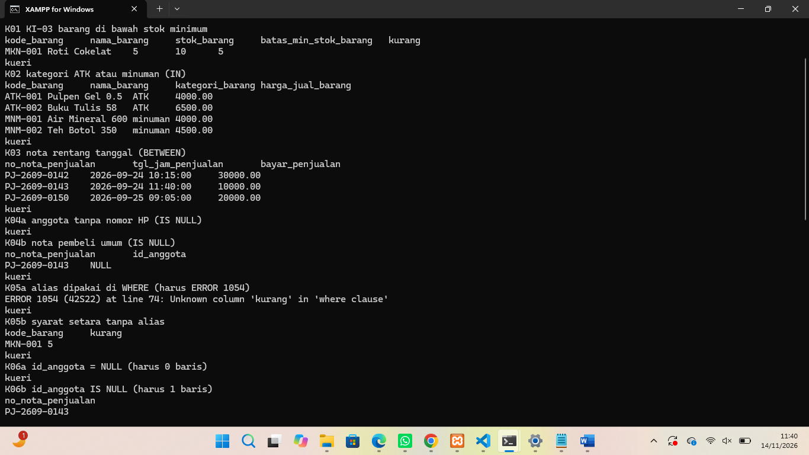
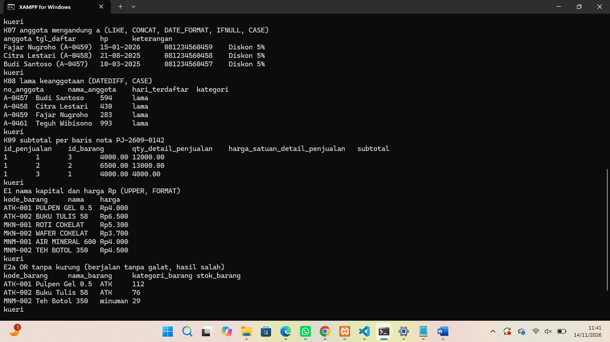
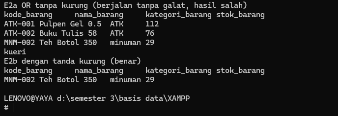
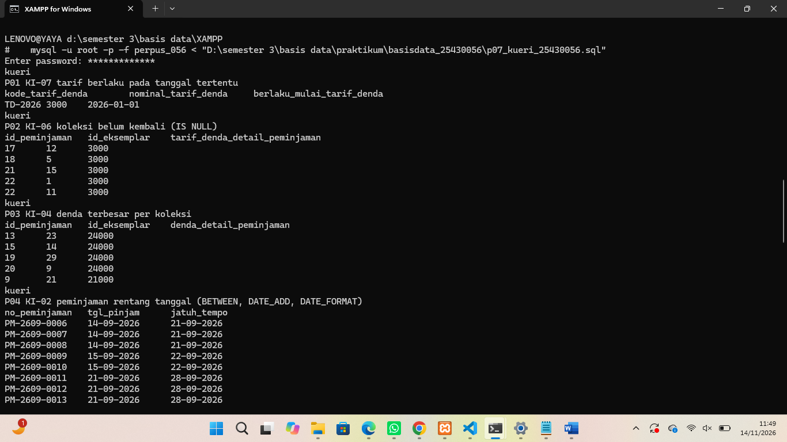
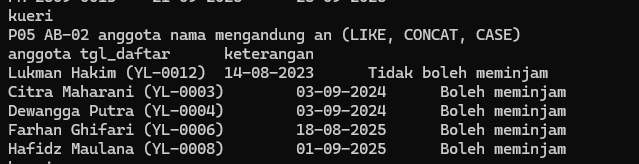
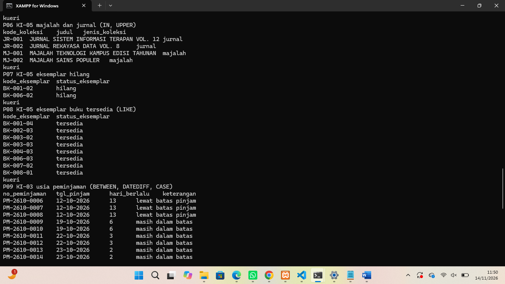
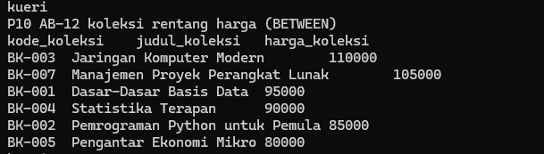
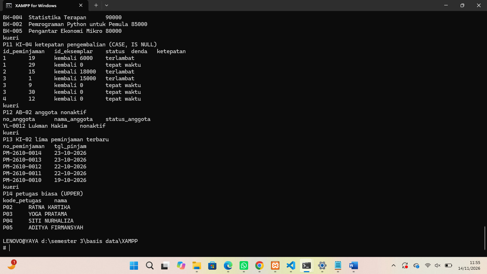
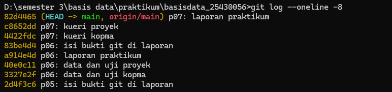

# Laporan Praktikum Basis Data - Pertemuan 07

**Nama:** Zahra Zakia An Nur  
**NPM:** 25430056  
**Kelas:** B  
**Tanggal:** 14 November 2026

## 1. Tujuan Praktikum

Pada pertemuan ini saya belajar bertanya kepada basis data dengan SELECT: memilih kolom dengan alias dan DISTINCT, menyaring baris dengan operator pembanding, logika, BETWEEN, IN, LIKE, dan IS NULL, mengurutkan dan membatasi hasil dengan ORDER BY dan LIMIT, serta memakai fungsi skalar untuk menyajikan hasil sesuai kebutuhan informasi (KI).

## 2. Ringkasan Dasar Teori

SELECT ditulis dengan urutan SELECT, FROM, WHERE, ORDER BY, LIMIT, tetapi dievaluasi dengan urutan lain: FROM dulu, lalu WHERE, lalu SELECT, lalu ORDER BY, dan terakhir LIMIT. Itu sebabnya alias kolom dapat dipakai di ORDER BY tetapi tidak di WHERE. Kesalahan yang paling berbahaya bukan galat sintaks, melainkan kesalahan semantik: kueri berjalan tanpa galat tetapi hasilnya tidak menjawab pertanyaan, sehingga setiap kueri dipasangkan dengan hasil yang diharapkan sebelum dijalankan.

NULL berarti tidak ada nilai atau tidak diketahui, bukan nol dan bukan string kosong. Perbandingan dengan NULL memakai IS NULL, karena `= NULL` tidak pernah bernilai benar. Fungsi skalar bekerja per baris: string (CONCAT, UPPER), tanggal (DATE_FORMAT, DATEDIFF, DATE_ADD), numerik (ROUND), dan kondisional (IF, IFNULL, CASE).

## 3. Hasil Langkah Percobaan (Kopma)

Berkas: `p07_kueri_kopma_25430056.sql`. Setiap kueri diberi komentar kode KI, pertanyaan sehari-hari, dan hasil yang diharapkan yang saya tulis sebelum menjalankannya. "Hari ini" memakai tanggal tetap 2026-10-25, bukan `CURDATE()`, supaya hasil tidak berubah dari hari ke hari.

| Kueri | KI | Pertanyaan | Hasil nyata |
|---|---|---|---|
| K01 | KI-03 | Barang di bawah stok minimum | 1 baris: MKN-001, stok 5, batas 10, kurang 5 |
| K02 | KI-03 | Kategori ATK atau minuman (IN) | 4 baris: ATK-001, ATK-002, MNM-001, MNM-002 |
| K03 | KI-01 | Nota pada 24 dan 25 September (BETWEEN) | 3 baris: PJ-2609-0142, PJ-2609-0143, PJ-2609-0150 |
| K04a | - | Anggota tanpa nomor HP (IS NULL) | 0 baris, semua anggota sampel punya nomor HP |
| K04b | KI-02 | Nota pembeli umum (IS NULL) | 1 baris: PJ-2609-0143 |
| K05a | - | Alias di WHERE | ERROR 1054 Unknown column 'kurang' in 'where clause' |
| K05b | KI-03 | Syarat setara tanpa alias | 1 baris: MKN-001, kurang 5 |
| K06a | - | `id_anggota = NULL` | 0 baris |
| K06b | - | `id_anggota IS NULL` | 1 baris: PJ-2609-0143 |
| K07 | AB-02 | Anggota bernama mengandung a | 3 baris: Fajar, Citra, Budi, semuanya Diskon 5% |
| K08 | - | Lama keanggotaan | 4 baris, semuanya kategori lama (283 sampai 993 hari) |
| K09 | - | Subtotal baris nota PJ-2609-0142 | 3 baris: 12.000, 13.000, 4.000 (jumlah 29.000) |







Jumlah manual K09 (12.000 + 13.000 + 4.000 = 29.000) sama dengan jumlah nota PJ-2609-0142 di dokumen Pertemuan 2. Penelusuran nota memakai `id_penjualan = 1` karena pencarian lewat nomor nota membutuhkan JOIN (Pertemuan 10).

## 4. Jawaban Titik Analisis

**Titik Analisis 1.** Mengganti ORDER BY kurang menjadi `WHERE kurang > 0` menghasilkan ERROR 1054: Unknown column 'kurang' in 'where clause'. Penyebabnya urutan evaluasi: WHERE dijalankan sebelum SELECT, sehingga alias `kurang` belum terbentuk saat syarat diperiksa, sedangkan ORDER BY dijalankan setelah SELECT dan boleh memakai alias. Syarat yang setara tanpa alias adalah mengulang ekspresinya: `WHERE batas_min_stok_barang - stok_barang > 0`, atau lebih sederhana `WHERE stok_barang < batas_min_stok_barang`.

**Titik Analisis 2.** `WHERE no_hp_anggota = NULL` tidak pernah mengembalikan baris karena NULL berarti tidak diketahui, sehingga perbandingan apa pun dengannya, termasuk kesamaan, menghasilkan tidak diketahui, bukan benar. Kueri yang benar adalah `WHERE no_hp_anggota IS NULL`. Data sampel Kopma tidak punya anggota tanpa nomor HP, sehingga saya memperagakannya pada kolom `id_anggota` di `penjualan`: `= NULL` menghasilkan 0 baris (K06a), sedangkan `IS NULL` menghasilkan nota pembeli umum PJ-2609-0143 (K06b). NULL berbeda dari string kosong `''`: string kosong adalah teks yang diketahui tetapi tidak berisi karakter, sedangkan NULL berarti tidak ada nilai sama sekali.

**Titik Analisis 3.** Subtotal per baris dihitung dari kolom pada baris itu sendiri (qty dikali harga satuan), sehingga SELECT biasa yang memproses baris satu per satu cukup. Total nota harus menjumlahkan banyak baris menjadi satu nilai, dan itu membutuhkan fungsi agregat SUM bersama GROUP BY, yang dipelajari di Pertemuan 9.

## 5. Hasil Latihan dan Modifikasi

**Latihan E1: nama kapital dan harga berformat Rp.** Kueri memakai `UPPER(nama_barang)` dan `CONCAT('Rp', FORMAT(harga_jual_barang, 0, 'id_ID'))`. Hasilnya enam baris, misalnya `PULPEN GEL 0.5` dengan `Rp4.000` dan `ROTI COKELAT` dengan `Rp5.300` (harga makanan sudah naik 5% di Latihan E2 Pertemuan 6).

**Latihan E2: kesalahan semantik tanpa galat.** Pertanyaannya adalah barang ATK atau minuman yang stoknya di bawah 40.

```sql
-- salah: AND diproses lebih dulu daripada OR
WHERE kategori_barang = 'ATK' OR kategori_barang = 'minuman' AND stok_barang < 40
-- benar: tanda kurung
WHERE (kategori_barang = 'ATK' OR kategori_barang = 'minuman') AND stok_barang < 40
```

Kueri yang salah berjalan tanpa galat dan mengembalikan tiga baris (ATK-001 stok 112, ATK-002 stok 76, dan MNM-002 stok 29), karena syarat stok hanya mengikat minuman sedangkan semua ATK lolos. Kueri yang benar hanya mengembalikan MNM-002.

## 6. Tugas Mandiri: Milestone Proyek 7

Berkas: `p07_kueri_25430056.sql` (proyek Yaya Library, database `perpus_056`). Berisi 14 kueri satu tabel, masing-masing dengan komentar kode KI, pertanyaan sehari-hari, dan hasil yang diharapkan yang ditulis sebelum dijalankan.

### Pemetaan kueri ke KI

| Kueri | KI | Pertanyaan | Operator atau fungsi |
|---|---|---|---|
| P01 | KI-07 (pendukung) | Tarif denda yang berlaku pada 7 September 2026 | `<=`, ORDER BY, LIMIT |
| P02 | KI-06 (pendukung) | Lima baris terlama yang koleksinya belum kembali | IS NULL |
| P03 | KI-04 (pendukung) | Lima denda per koleksi terbesar | `>`, ORDER BY, LIMIT |
| P04 | KI-02 (pendukung) | Peminjaman 14 sampai 21 September dan jatuh tempo | BETWEEN, DATE_ADD, DATE_FORMAT |
| P05 | AB-02 | Lima anggota terlama bernama mengandung "an" | LIKE, CONCAT, CASE |
| P06 | KI-05 (pendukung) | Judul majalah dan jurnal | IN, UPPER |
| P07 | KI-05 | Eksemplar yang hilang | `=` |
| P08 | KI-05 (pendukung) | Delapan eksemplar buku yang tersedia | LIKE, AND |
| P09 | KI-03 (pendukung) | Usia peminjaman 12 sampai 23 Oktober | BETWEEN, DATEDIFF, CASE |
| P10 | AB-12 | Koleksi berharga 80.000 sampai 110.000 | BETWEEN |
| P11 | KI-04 (pendukung) | Ketepatan pengembalian pada empat peminjaman pertama | CASE, IS NULL |
| P12 | AB-02 | Anggota tidak aktif | `<>` |
| P13 | KI-02 (pendukung) | Lima peminjaman terbaru | ORDER BY, LIMIT, DATE_FORMAT |
| P14 | - | Petugas biasa dengan nama huruf kapital | `=`, UPPER |

Cakupan operator dan fungsi yang diminta terpenuhi: LIKE (P05, P08), BETWEEN (P04, P09, P10), IN (P06), IS NULL (P02, P11), CASE (P05, P09, P11), fungsi tanggal (DATE_ADD di P04, DATEDIFF di P09), dan fungsi string (CONCAT di P05, UPPER di P06 dan P14).











### KI yang belum dapat dijawab dengan satu tabel

| KI | Alasan | Dijawab di |
|---|---|---|
| KI-01 koleksi paling sering dipinjam per bulan | Perlu menghitung (COUNT) dan mengelompokkan (GROUP BY), serta menggabungkan detail_peminjaman, peminjaman, eksemplar, dan koleksi | Pertemuan 9 sampai 12 |
| KI-02 anggota paling aktif per bulan | Perlu COUNT dan GROUP BY | Pertemuan 9 |
| KI-03 koleksi lewat batas kembali | Perlu JOIN lima tabel (P02 dan P09 hanya mencakup sebagian) | Pertemuan 10 sampai 12 |
| KI-04 total denda per bulan | Perlu SUM, serta JOIN ke peminjaman untuk mengetahui bulannya | Pertemuan 9 sampai 10 |
| KI-05 jumlah eksemplar per status untuk setiap judul | Perlu COUNT, GROUP BY, dan JOIN | Pertemuan 9 sampai 10 |
| KI-06 koleksi belum kembali pada satu transaksi | Perlu JOIN karena pencarian memakai nomor peminjaman | Pertemuan 10 |
| KI-07 bukti tarif pada transaksi lama | Perlu JOIN detail dengan peminjaman (P01 hanya menjawab tarif berlaku pada suatu tanggal) | Pertemuan 10 |

### Alasan pemilihan fungsi skalar

1. **DATE_FORMAT** mengubah tanggal menjadi format Indonesia (hari-bulan-tahun) agar mudah dibaca petugas.
2. **DATE_ADD** menghitung jatuh tempo dari `tgl_pinjam` plus 7 hari (AB-06). Jatuh tempo tidak disimpan karena tergolong nilai turunan (Pertemuan 4).
3. **DATEDIFF** menghitung usia peminjaman dalam hari. Tanggal acuan 2026-10-25 ditulis tetap, bukan `CURDATE()`, supaya hasil yang diharapkan tidak berubah dari hari ke hari.
4. **CASE** menerjemahkan status dan angka menjadi keterangan yang mudah dipahami (boleh meminjam, tepat waktu, terlambat), dan lebih jelas daripada IF bersarang.
5. **CONCAT dan UPPER** menyusun label anggota dan menyeragamkan huruf kapital untuk tampilan.

## 7. Pembahasan dan Kendala

Kendala pertama adalah alias di WHERE (Titik Analisis 1). Saya mengira alias seperti `kurang` bisa dipakai di mana saja, padahal WHERE dievaluasi sebelum SELECT. Sejak itu saya membaca kueri dalam urutan evaluasi, bukan urutan penulisan.

Kendala kedua adalah bahwa kesalahan tanpa galat lebih sulit dilihat. Pada Latihan E2, kueri tanpa tanda kurung berjalan normal dan menampilkan hasil yang tampak masuk akal, tetapi ada tiga baris, padahal seharusnya satu. Menulis hasil yang diharapkan sebelum menjalankan membantu saya menyadari perbedaannya.

Kendala ketiga adalah alias yang namanya sama dengan kolom. Di Kopma saya sudah mengantisipasinya pada K07 dengan alias `tgl_daftar`, tetapi pada kueri proyek saya mengulang kesalahan yang sama dan baru terlihat saat dijalankan (lihat perbedaan di bawah).

Kendala keempat adalah KI proyek yang ternyata hampir semuanya membutuhkan agregasi atau JOIN. Hanya potongan setiap KI yang dapat dijawab dengan satu tabel, sehingga saya menandai sisanya untuk Pertemuan 9 sampai 12.

**Perbedaan antara hasil yang diharapkan dan hasil nyata.** Pada P13 (lima peminjaman terbaru) saya mengharapkan PM-2610-0014 sampai PM-2610-0010 (tanggal 23, 22, dan 19 Oktober), tetapi hasil nyata menampilkan PM-2609-0016, PM-2609-0015, dan PM-2609-0014 (28 September) lebih dulu. Penyebabnya, `DATE_FORMAT(tgl_pinjam, '%d-%m-%Y') AS tgl_pinjam` membuat alias bernama sama dengan kolom, sehingga `ORDER BY tgl_pinjam` mengurutkan teks hari-bulan-tahun, bukan tanggal: "28-09-2026" lebih besar daripada "23-10-2026" sebagai teks. Perbaikannya memakai nama kolom asli, `ORDER BY peminjaman.tgl_pinjam DESC`. Kueri P04 dan P09 punya kelemahan yang sama dan memberi urutan benar hanya karena semua tanggalnya berada dalam satu bulan, sehingga keduanya ikut saya perbaiki dengan cara yang sama.

## 8. Kesimpulan

SELECT dievaluasi dengan urutan yang berbeda dari urutan penulisannya, sehingga alias tidak dapat dipakai di WHERE dan NULL harus dibandingkan dengan IS NULL. Kesalahan semantik tidak menimbulkan galat, sehingga hasil yang diharapkan harus ditulis sebelum kueri dijalankan. Kueri satu tabel hanya menjawab sebagian KI proyek, dan sisanya menunggu agregasi dan JOIN di pertemuan berikutnya.

## 9. Pernyataan Penggunaan AI

| Butir | Isian |
|---|---|
| Alat yang dipakai | Claude (Anthropic) |
| Dipakai untuk | Membuat draf kueri Kopma dan proyek beserta komentar KI dan hasil yang diharapkan, serta draf laporan ini, atas izin dosen |
| Bagian laporan terkait | Bagian 1 sampai 8 (draf awal), yang saya baca, periksa, dan ubah dengan bahasa sendiri |
| Yang dikerjakan sendiri | menjalankan kueri di MariaDB, mencocokkan hasil nyata dengan hasil yang diharapkan, mengambil tangkapan layar, dan commit |

## 10. Bukti Git

Tautan repositori: https://github.com/zahraazakiaannur-cmd/basisdata_25430056

| Hash commit | Pesan commit | Keterangan |
|---|---|---|
| | p07: kueri kopma | `p07_kueri_kopma_25430056.sql` |
| | p07: kueri proyek | `p07_kueri_25430056.sql` |
| | p07: laporan praktikum | Laporan dan gambar pendukung |



## Checklist

**Checklist umum**

- [ ] Identitas: nama, NIM, kelas, pertemuan, tanggal, nama asisten/dosen
- [ ] Tujuan: bahasa sendiri, maksimal 5 baris
- [ ] Ringkasan teori: pemahaman sendiri, maksimal setengah halaman
- [ ] Langkah percobaan (D): tangkapan layar langkah kunci dengan keterangan
- [ ] Titik Analisis: semua dijawab lengkap dengan alasan
- [ ] Latihan (E): hasil latihan beserta bukti
- [ ] Tugas Mandiri (F): berkas, bukti, dan penjelasan keputusan desain
- [ ] Pembahasan dan kendala
- [ ] Kesimpulan: dua sampai empat kalimat
- [ ] Pernyataan Penggunaan AI
- [ ] Bukti Git: tautan repositori dan hash commit berpesan `p07: ...`

**Checklist khusus Pertemuan 7**

- [ ] Berkas wajib: `p07_kueri_25430056.sql` berisi minimal 10 kueri satu tabel, masing-masing diberi komentar KI dan hasil yang diharapkan
- [ ] Bukti tangkapan layar: hasil setiap kueri
- [ ] Analisis wajib: pemetaan kueri ke KI; alasan pemilihan fungsi skalar yang dipakai